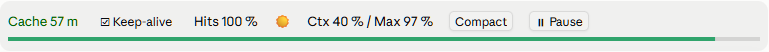

# cache-weather-and-pause-resume

[](https://github.com/DarthSonic/cache-weather-and-pause-resume/actions/workflows/ci.yml)
[](LICENSE)

*English: [README.md](README.md)*

Ein Mod für [Claude Code](https://code.claude.com): eine schmale Leiste direkt über dem Eingabefeld. Sie zeigt, wie
warm der Prompt-Cache noch ist und wie voll der Kontext, mit einem **Compact**-Knopf, einem Knopf
**Pause / Weitermachen**, der Claude Laufendes zu Ende bringen, den Stand sichern und warten lässt, und einem Haken
**Keep-alive**, der den Cache kurz vor Ablauf auffrischt.




## Beispiele

1. **Weggehen, während ein langer Lauf läuft.** Claude hat eine Testsuite im Hintergrund laufen, und du musst los.
   Drück **⏸ Pause**: Claude startet nichts Neues, lässt den Lauf zu Ende laufen (oder fragt dich vorher, mit der
   Restlaufzeit, wenn er länger als 5 Minuten braucht), hält den Stand fest und meldet „Pausiert“. Zurück am Platz
   drückst du **▶ Weitermachen**, und Claude macht dort weiter, auch nach einem Neustart der App.
2. **Zurück sein, bevor der Cache abläuft.** Die Leiste zählt den Prompt-Cache ab der letzten Antwort herunter, etwa
   `Cache 12 m`. Schickst du deine nächste Nachricht, bevor dort „abgelaufen“ steht, liest die Anfrage die Unterhaltung
   aus dem Cache, statt alles neu zu schreiben und zu bezahlen; **Hits** zeigt, wie viel aus dem Cache kam.
3. **Verdichten, wann es dir passt.** Das Wetter wird ⛈️, wenn der Kontext der Auto-Compact-Schwelle nahekommt
   (`Ctx 87 % / Max 97 %`). Drück **Compact** zwischen zwei Aufgaben, statt ein Auto-Compact mitten in eine geraten zu
   lassen; danach schreibt die Leiste die Zusammenfassung ins Log, mit der Claude weitermacht.
4. **Den Cache durch einen langen Lauf oder eine Pause warm halten.** Claude wartet auf einen Build, der 70 Minuten
   dauert, oder du bist in einer Besprechung. Setz den Haken **Keep-alive**: Kurz bevor der Cache abläuft, frischt der
   Mod ihn auf, und die nächste Anfrage liest die Unterhaltung aus dem Cache, statt alles neu zu schreiben.

Tippen geht auch: „pausieren“ pausiert, „weitermachen“ setzt fort (auf Englisch “pause” und “continue”).

## Was die Leiste zeigt

| Teil | Was er zeigt |
| --- | --- |
| **Cache** | Restzeit des Prompt-Caches in Minuten (`m`) ab der letzten Antwort oder Auffrischung durch Keep-alive; grün, ab 60 % Rest gelb, ab 20 % rot, bei 0 „abgelaufen“. Jede Minute neu gezeichnet. |
| **Keep-alive** | Ein Haken, im Terminal `[ ]` / `[✓]`, in der Desktop-App ☐ / ☑: frischt den Cache kurz vor Ablauf auf (unten). `↻2` zählt die Auffrischungen seit der letzten Anfrage; daneben, warum Keep-alive wartet, wenn es wartet. |
| **Hits** | Anteil der Input-Tokens der letzten Antwort, der aus dem Cache kam. |
| **Wetter** | ☀️ bis zur Hälfte der Auto-Compact-Schwelle, 🌧️ bis 80 % davon, ⛈️ darüber. Im Terminal ☼ (gelb), ≋ (hellblau) und ↯ (rot). |
| **Ctx / Max** | Füllung des Kontexts in Prozent und die Auto-Compact-Schwelle (`*` = Ersatzwert 83 %, wenn die Sitzung keine meldet). |
| **Compact** | Wie `/compact`; bei ⛈️ hervorgehoben. In der Desktop-App oder während Claude arbeitet wird `/compact` eingereiht. |
| **⏸ Pause / ▶ Weitermachen** | Bittet Claude, die Sitzung zu pausieren, und setzt sie fort (unten). Im Terminal `❚❚ Pause` und `► Weitermachen`. |
| **Cache-Balken** | Eine eigene Zeile unter der Leiste, über ihre ganze Breite, gefärbt wie die Cache-Restzeit: im Terminal eine Linie in der Mitte der Zeile, in der Desktop-App ein Balken von wenigen Pixeln Höhe. |

Ist der Cache abgelaufen, sind Hits, Ctx und Max bis zur nächsten Antwort ausgeblendet: Sie beschreiben dann eine
Anfrage, die nicht mehr aus dem Cache liest.

Im Terminal zeigt die Leiste schmale Zeichen statt Emoji: Terminals zählen die Breite eines Emoji auf ihre eigene Art
(manche eine Spalte, Claude Code zwei), und die Leiste behielte sonst Reste eines früheren Bilds. Die Desktop-App
zeichnet die Emoji.

Nach `/compact` (oder dem Knopf) schreibt der Mod die Tokens vorher und nachher und die Zusammenfassung, mit der Claude
weitermacht, als Log-Zeilen, die das Modell nicht liest.

## Der Pause-Knopf

| Zustand | Leiste | Was passiert |
| --- | --- | --- |
| läuft | `⏸ Pause` | Ein Klick schickt Claude die Pause-Bitte. |
| Pause angefordert | `⏳ Pause angefordert · 2 Tasks laufen noch` | Claude lässt Laufendes zu Ende laufen, fragt bei langen Tasks nach und sichert den Stand. Getipptes „weitermachen“ nimmt die Bitte zurück. |
| pausiert | `▶ Weitermachen` · `pausiert seit 12 m` | Claude wartet. Ein Klick schickt „weitermachen“, genau wie getippt. |

Tippen geht auch: eine Nachricht, die nur „pausieren“ (oder „pause“) ist, pausiert; eine, die mit „weitermachen“ (oder
„continue“, „resume“) beginnt, setzt fort. Beide Sprachen werden verstanden, egal in welcher der Mod gerade spricht.

Die Bitte an Claude (der genaue Text steht in [`hooks/pause.ts`](hooks/pause.ts)):

1. Nichts Neues mehr starten; was läuft, läuft zu Ende.
2. Je laufendem Hintergrund-Task (Läufe, Agenten, Monitore, Workflows) die Restlaufzeit schätzen. Länger als die
   Schwelle (Standard **5 Minuten**, Option `askAboveMinutes`) oder ohne absehbares Ende: per Dialog fragen, mit
   Restlaufzeit je Task, ob er jetzt beendet und nach „weitermachen“ neu gestartet (nur, wenn er das zulässt) oder zu
   Ende gefahren wird. Kürzere Tasks wartet Claude einfach ab.
3. Den Stand nach den Regeln des Projekts sichern (CLAUDE.md, Memory): erledigt, gelaufen, abgebrochen samt Neustart,
   nächster Schritt. Ohne Projektregel nichts verwerfen und nicht ungefragt committen.
4. Kurz „Pausiert“ melden und warten. Geplante Weckungen (Cron, `/loop`) laufen in der Pause nicht.

Bei „weitermachen“ bekommt Claude den Hinweis, am gesicherten Stand fortzusetzen und Abgebrochenes neu zu starten. Eine
andere Nachricht in der Pause wird beantwortet, ohne die pausierte Arbeit wieder aufzunehmen.

Wie der Mod den Zustand verfolgt:

- **Klick, während Claude arbeitet:** die Bitte kommt als Zeile in den laufenden Zug, Claude liest sie bei der nächsten
  Anfrage (nach dem gerade laufenden Werkzeugaufruf). Endet der Zug vorher, hält der Stop-Hook das Anhalten auf und
  reicht die Bitte weiter; nach einem abgebrochenen Zug trägt die nächste Nachricht sie.
- **Klick, während Claude ruht:** die Bitte geht als Prompt mit deinen Worten.
- **Pausiert** ist die Sitzung, sobald Claude anhält und der Stop-Hook keine Hintergrund-Arbeit mehr meldet. Laufen
  noch Tasks, zählt die Leiste sie.
- Eine Pause wird je Sitzung in `~/.claude/cache-weather-and-pause-resume/state.json` gemerkt: eine pausierte Sitzung, die wieder
  geöffnet wird (Neustart der App, fortgesetzte Sitzung), zeigt wieder **Weitermachen**. `/clear` hebt die Pause auf.

## Keep-alive

Der Prompt-Cache hält die Unterhaltung 5 Minuten oder 1 Stunde, nachdem die letzte Anfrage sie gelesen hat. Ist er
abgelaufen, schreibt die nächste Anfrage alles neu: zum 1,25-fachen (5 Minuten) oder 2-fachen (1 Stunde) des normalen
Input-Preises, wo ein Lesen ein Zehntel davon oder weniger kostet. Mit gesetztem **Keep-alive** frischt der Mod den
Cache kurz vor Ablauf auf:

- **Wann:** eine Minute vor dem Ende eines 5-Minuten-Caches, fünf Minuten vor dem Ende eines 1-Stunden-Caches.
- **Wie:** eine Frage über die Unterhaltung, so wie ihre letzte Anfrage sie geschickt hat (`$.model.fork`, über den
  eigenen Client und die Anmeldung der Sitzung). Die API liest alles aus dem Cache, und das hält den Cache eine weitere
  volle Laufzeit. Die Frage ist fester Text („antworte mit OK“, in [`hooks/register.tsx`](hooks/register.tsx)); sie darf
  kein Werkzeug aufrufen, und Frage und Antwort bleiben außerhalb der Unterhaltung. Jede Auffrischung schreibt eine
  graue Zeile: die aus dem Cache gelesenen Tokens und die Tokens der Antwort.
- **Während Claude arbeitet** (ein langer Lauf, ein Subagent, eine angeforderte Pause): so lange es dauert.
- **Während die Sitzung ruht oder pausiert ist:** beim 1-Stunden-Cache 8 Stunden, beim 5-Minuten-Cache 45 Minuten, ab
  der letzten Anfrage oder Eingabe. Dann steht in der Leiste „endete nach 8 h ohne Eingabe“, und eine Zeile erklärt
  den Grund: Eine vergessene Sitzung soll nicht weiter kosten. Deine nächste Nachricht baut den Cache neu auf, dann
  übernimmt Keep-alive wieder.
- **Findet eine Auffrischung den Cache schon abgelaufen** (etwa weil der Rechner schlief), wartet Keep-alive auf die
  nächste Anfrage, statt ihn neu aufzubauen, und sagt das.
- **Nur du schaltest:** Der Mod setzt oder löscht den Haken nie. Er gilt für diese Sitzung: Ein Neustart oder
  Fortsetzen behält ihn, eine neue Sitzung und `/clear` starten ohne.

Eine Auffrischung ist eine eigene Anfrage und wird wie eine abgerechnet oder gezählt: Sie liest den ganzen Kontext aus
dem Cache, dazu ein paar Tokens Antwort. Sie lohnt sich, wenn die nächste Anfrage später kommt, als der Cache gehalten
hätte.

## Installation

Der Mod steht im Marketplace `darthsonic`, dem Katalog
[DarthSonic/claude-plugins](https://github.com/DarthSonic/claude-plugins); jedes Plugin darin hat ein eigenes Repository.
Im Eingabefeld einer Claude-Code-Sitzung im Terminal:

```
/plugin marketplace add DarthSonic/claude-plugins
/plugin install cache-weather-and-pause-resume@darthsonic
```

Einen Bereich wählen (Benutzer: alle Projekte). Dasselbe aus einer Shell:

```
claude plugin marketplace add DarthSonic/claude-plugins
claude plugin install cache-weather-and-pause-resume@darthsonic --scope user
```

Ein Mod, der im Terminal für den Benutzer-Bereich installiert wurde, lädt auch im Code-Tab der Claude-Desktop-App.

**Wer von `cache-wetter` kommt** (der Name bis 0.5.0): den alten zuerst entfernen, mit
`claude plugin uninstall cache-wetter@cache-wetter` und `claude plugin marketplace remove cache-wetter`. Seine
Zustandsdatei (`~/.claude/cache-wetter/`) wird nicht übernommen und kann weg.

**Nach einem Update eine neue Sitzung öffnen.** Die Desktop-App reicht den Mod beim Start der Sitzung herein;
`/reload-plugins` tauscht ihn dort nicht aus. Welche Fassung eine Sitzung ausführt, steht bei jedem Laden als
`codeVersion` in `~/.claude/cache-weather-and-pause-resume/state.json`.

## Einstellungen

| Option | Standard | Wirkung |
| --- | --- | --- |
| `language` | `auto` | `de` oder `en` für Leiste, Meldungen und die Texte an Claude. `auto` folgt `LC_ALL` / `LC_MESSAGES` / `LANG`, dann der Systemsprache (unter Windows, wo `LANG` meist leer ist). |
| `askAboveMinutes` | `5` | Ab welcher Restlaufzeit eines laufenden Tasks Claude bei einer Pause nachfragt. |

Setzen mit `/plugin configure cache-weather-and-pause-resume@darthsonic` oder in `~/.claude/settings.json`:

```json
"pluginConfigs": {
  "cache-weather-and-pause-resume@darthsonic": { "options": { "language": "de", "askAboveMinutes": 10 } }
}
```

## Die Leiste teilen

Der Platz über dem Eingabefeld ist ein Platz mit einer Kette von Mods. Ein Mod, der nur seine eigene Leiste
zurückgibt, verdeckt alles unter ihm in der Kette, und welcher Mod oben steht, entscheidet die Lade-Reihenfolge, nicht
der Mod. cache-weather-and-pause-resume ruft den Rest der Kette und setzt dessen Leiste unter die eigene Zeile, mit einem Abstand, der
nur zwischen den beiden entsteht. Ein anderer Mod, der es genauso macht (etwa
[savvy-progress](https://github.com/JohnnyVizz/claude-kit) seit 1.2.1), erscheint in jeder Reihenfolge mit ihm
zusammen.

## Woher die Werte kommen

- **Cache-Laufzeit (5 min / 1 h):** aus dem Transkript der Sitzung, das jede Cache-Schreibung getrennt nach Laufzeit
  meldet (`ephemeral_5m_input_tokens`, `ephemeral_1h_input_tokens`); die letzte, die etwas schrieb, entscheidet. Ein
  Transkript über 3,5 MiB liest der Mod nicht (seit Claude Code 2.1.300 hält ein Transkript auch den System-Prompt und
  die Tools jeder Anfrage fest, eine lange Sitzung kommt also früh dorthin). Bei einem Modellwechsel entscheidet dessen
  Meldung, und der Start einer fortgesetzten Sitzung verrät sie, wenn die letzte Antwort 5 bis 60 Minuten her ist (ob
  Claude Code den Cache als wahrscheinlich abgelaufen meldet). Bis zu einer eigenen Ablesung zeigt eine Sitzung die
  zuletzt gesehene Laufzeit: ohne Zusatz, wenn eine Sitzung sie am letzten Tag gelesen hat (sie folgt der Einstellung
  deines Kontos, nicht der Sitzung), sonst mit `?`.
- **Trefferquote und Zeitpunkt der letzten Antwort:** aus jeder Modellanfrage der Hauptunterhaltung; in einer
  fortgesetzten Sitzung bis zur ersten Anfrage aus der Meldung des Sitzungsstarts, wie lange die letzte Antwort her ist.
- **Kontext und Schwelle:** `$.session.usage()`; die Schwelle aus der lokalen Schätzung (keine API-Anfrage).

## Was der Mod auf deinem Rechner tut

cache-weather-and-pause-resume startet keine Programme und stellt selbst keine Netzwerk-Anfragen, außer den Auffrischungen von
Keep-alive, die du je Sitzung einschaltest. Was er Claude übergibt, kommt wie alles, was du schickst, in die
Unterhaltung:

| Was | Wann | Genau |
| --- | --- | --- |
| ein Prompt in deinem Namen | du drückst **Pause**, während Claude ruht | die Pause-Bitte: fester Text aus [`hooks/pause.ts`](hooks/pause.ts), mit deinem `askAboveMinutes` |
| ein Prompt in deinem Namen | du drückst **Weitermachen** | „weitermachen“ (auf Englisch “continue”) |
| eine Zeile in der Unterhaltung | du drückst **Pause**, während Claude arbeitet, oder **Weitermachen** | die Pause-Bitte; ein fester Hinweis, dass die Pause vorbei ist, mit ihrer Dauer in Minuten |
| ein Hinweis an deinem Prompt | eine Pause ist angefordert oder läuft, oder du tippst „pausieren“ oder „weitermachen“ | ein fester Hinweis (die Bitte, „die Sitzung ist pausiert“, „die Pause ist beendet“); dein getippter Text bleibt unverändert, und kein Prompt wird zurückgehalten |
| der Slash-Befehl `/compact` | du drückst **Compact**, während Claude arbeitet, oder in der Desktop-App | eingereiht wie ein getipptes `/compact`; sonst verdichtet der Knopf über den eigenen Compact-Aufruf der Sitzung |
| die Antwort des Stop-Hooks | Claude hält an, bevor es die Pause-Bitte gelesen hat | Claude macht einmal weiter, mit der Pause-Bitte als Grund |
| eine Frage neben der Unterhaltung | **Keep-alive** ist gesetzt und der Cache läuft gleich ab | eine Modell-Anfrage über die Unterhaltung, so wie ihre letzte Anfrage sie geschickt hat, über den eigenen Client der Sitzung: fester Text, der um „OK“ bittet, keine Werkzeuge; die Antwort wird verworfen und bleibt außerhalb der Unterhaltung |

In diese Texte gelangt kein Dateiinhalt, kein Transkript-Text und keine Einstellung. Die Anfrage von Keep-alive trägt
die Unterhaltung, die die Sitzung mit jeder Anfrage ohnehin schickt, an dieselbe API.

**Dateien.** Der Mod schreibt genau eine Datei, `~/.claude/cache-weather-and-pause-resume/state.json` (unten), und keine andere: keine
Einstellungen, Anweisungen, Hooks oder Build-Dateien. Er liest diese Datei, das Transkript der Sitzung, wenn es höchstens
3,5 MiB groß ist (für Cache-Laufzeit und Zeitpunkt der letzten Antwort), und die Dateinamen — nicht die Inhalte — in
`~/.claude/projects/*/`, um die Pausen gelöschter Sitzungen zu streichen.

**Umgebung und Einstellungen.** Er liest `USERPROFILE` / `HOME` (wo der Benutzerordner liegt) und `LC_ALL` /
`LC_MESSAGES` / `LANG` (die Sprache). Er liest keine Einstellungen von Claude Code und keine Zugangsdaten.

**Hooks.** Die Hooks auf `prompt.submit` und `classic.Stop` handeln wie in der Tabelle. Jeder andere Hook liest nur und
reicht sein Ereignis unverändert weiter: `classic.SessionStart` (Transkript-Pfad, Sitzungs-ID, Zeit seit der letzten
Antwort), `classic.Stop` (Transkript-Pfad, laufende Hintergrund-Tasks), `classic.PostModelSwitch` (die
Cache-Laufzeit), `turn.step` (Token-Zahlen, und wann eine Anfrage den Cache liest) und `session.measure`
(Token-Zahlen), `turn.start`, `turn.complete`, `session.end` und
`session.compact`, nach dem er die Zusammenfassung als Log-Zeilen schreibt, die das Modell nicht liest. Der Hook auf
`ui.render` zeichnet die Leiste und stapelt die Leisten anderer Mods darunter.

## Zustandsdatei

`~/.claude/cache-weather-and-pause-resume/state.json` hält die pausierten Sitzungen und die Sitzungen mit gesetztem Keep-alive (je
Sitzungs-ID), die zuletzt gesehene Cache-Laufzeit und die zuletzt geladene Fassung. Sie
behält von beidem höchstens die 20 jüngsten, und zehn Sekunden nach einem Sitzungsstart fällt heraus, was sie von
gelöschten Sitzungen hält (kein Transkript mehr unter `~/.claude/projects/`); im Zweifel bleibt alles stehen. Die Datei liest nur der Mod — sie gelangt nie zum Modell und
kostet keine Token.

## Voraussetzungen

Claude Code mit Mods (Plugins mit Funktions-Hooks), Early Access, geprüft mit **2.1.295** (Desktop-App) und **2.1.300** (CLI). Die
Mod-Schnittstelle ändert sich zwischen Releases; die CI prüft und testet gegen eine festgeschriebene Version.

Wo eine Organisation Claude Code verwaltet, laufen die Hooks auf `classic.SessionStart`, `classic.Stop`,
`classic.PostModelSwitch` und `session.compact` nur für Plugins, die die Organisation in den verwalteten Einstellungen
nennt. Eine selbst installierte Kopie sieht dann nie, dass Claude anhält: die Pause bleibt bei „Pause angefordert“, die
Cache-Laufzeit wird nicht aus dem Transkript gelesen, und nach `/compact` erscheint keine Zusammenfassung.

## Entwicklung

```
claude plugin validate .
claude plugin test .
```

Die Tests (`tests/`) laufen im Test-Kit von Claude Code auf den Oberflächen Terminal und Desktop und legen die Sprache
fest, damit sie nicht von der Locale des Rechners abhängen. Eine Änderung erreicht die eigenen Sitzungen nach einer
höheren Version in `.claude-plugin/plugin.json`, `claude plugin update cache-weather-and-pause-resume@darthsonic` und einer neuen
Sitzung.

## Hilfe

Fragen, Fehler und Ideen: [GitHub-Issues](https://github.com/DarthSonic/cache-weather-and-pause-resume/issues). Der
Mod braucht kein Konto und keine Beispieldaten: installieren und eine Sitzung öffnen.

## Danksagung

cache-weather-and-pause-resume basiert auf einer Idee von Julian Ivanov ([KI-Automatisierungs-Community](https://ki-automatisierungs-community.de/)).

Geschrieben mit Claude Code (Claude Opus 5.5); geprüft, getestet und gepflegt von Sven Moderow.

## Lizenz

[MIT](LICENSE) © 2026 Sven Moderow
