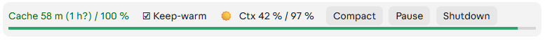
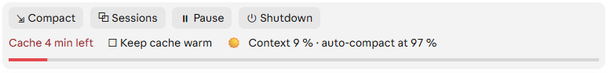
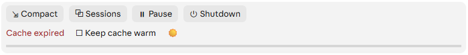
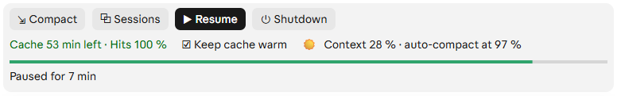

# cache-weather-and-pause-resume

[](https://github.com/DarthSonic/cache-weather-and-pause-resume/releases/latest)
[](https://github.com/DarthSonic/cache-weather-and-pause-resume/actions/workflows/ci.yml)
[](LICENSE)
[](https://www.claudepluginhub.com/plugins/darthsonic-cache-weather-and-pause-resume?ref=badge)

*English: [README.md](README.md)*


> [!TIP]
> **Kostenlos und Open Source.** Spart dir die Leiste Zeit oder Cache, kannst du ihre Weiterentwicklung unterstützen:
>
> [](https://github.com/sponsors/DarthSonic)

Ein Mod für [Claude Code](https://code.claude.com): eine schmale Leiste direkt über dem Eingabefeld. Sie zeigt, wie
warm der Prompt-Cache noch ist und wie voll der Kontext, mit einem **Compact**-Knopf, einem Knopf
**Pause / Weiter**, der Claude Laufendes zu Ende bringen, den Stand sichern und warten lässt, einem Haken
**Keep-warm**, der den Cache kurz vor Ablauf auffrischt, und einem Knopf **Shutdown**, der die Sitzung pausiert und
danach den Rechner herunterfährt.

## Beispiele

1. **Weggehen, während ein langer Lauf läuft.** Claude hat eine Testsuite im Hintergrund laufen, und du musst los.
   Drück **Pause**: Claude startet nichts Neues, lässt den Lauf zu Ende laufen (oder fragt dich vorher, mit der
   Restlaufzeit, wenn er länger als 5 Minuten braucht), hält den Stand fest und meldet „Pausiert“. Zurück am Platz
   drückst du **Weiter**, und Claude macht dort weiter, auch nach einem Neustart der App.
2. **Zurück sein, bevor der Cache abläuft.** Die Leiste zählt den Prompt-Cache ab der letzten Antwort herunter, etwa
   `Cache 12 m`. Schickst du deine nächste Nachricht, bevor dort „abgelaufen“ steht, liest die Anfrage die Unterhaltung
   aus dem Cache, statt alles neu zu schreiben und zu bezahlen; der Anteil hinter dem Schrägstrich (`Cache 12 m / 98 %`)
   zeigt, wie viel aus dem Cache kam.
3. **Verdichten, wann es dir passt.** Das Wetter wird ⛈️, wenn der Kontext der Auto-Compact-Schwelle nahekommt
   (`Ctx 87 % / 97 %`). Drück **Compact** zwischen zwei Aufgaben, statt ein Auto-Compact mitten in eine geraten zu
   lassen; danach schreibt die Leiste die Zusammenfassung ins Log, mit der Claude weitermacht.
4. **Den Cache durch einen langen Lauf oder eine Pause warm halten.** Claude wartet auf einen Build, der 70 Minuten
   dauert, oder du bist in einer Besprechung. **Keep-warm**, standardmäßig an, frischt den Cache kurz vor Ablauf auf,
   und die nächste Anfrage liest die Unterhaltung aus dem Cache, statt alles neu zu schreiben.
5. **Feierabend.** Drück **Shutdown**: Claude fragt sofort nach allem Langen, das noch läuft, und pausiert dann wie bei
   **Pause**, die anderen Sitzungen mit; sobald alle pausiert sind, zählt die Leiste 5 Minuten herunter und fährt den
   Rechner herunter.

Tippen geht auch: „pausieren“ pausiert, „weitermachen“ setzt fort (auf Englisch “pause” und “continue”). Oder bitte
Claude in eigenen Worten darum („lass uns für heute Schluss machen“): Sobald pausiert ist, sagt Claude es der Leiste,
und die zeigt **Weiter**.

## Was die Leiste zeigt




| Teil | Was er zeigt |
| --- | --- |
| **Cache** | Restzeit des Prompt-Caches in Minuten ab der letzten Antwort oder Auffrischung durch Keep-warm; grün, ab 60 % Rest gelb, ab 20 % rot, bei 0 „abgelaufen“. Jede Minute neu gezeichnet. Dahinter die Trefferquote: der Anteil der Input-Tokens der letzten Antwort, der aus dem Cache kam (`Cache noch 42 min · Treffer 98 %` in der Desktop-App, `Cache 42 m / 98 %` im Terminal). |
| **Keep-warm** | Ein Haken, in der Desktop-App „☐ / ☑ Cache warm halten“, im Terminal `[ ]` / `[✓] Keep-warm`, standardmäßig gesetzt: frischt den Cache kurz vor Ablauf auf (unten). „(2× aufgefrischt)“, im Terminal `↻2`, zählt die Auffrischungen seit der letzten Anfrage; warum Keep-warm wartet, wenn es wartet, steht in der Statuszeile. |
| **Wetter** | ☀️ bis zur Hälfte der Auto-Compact-Schwelle, 🌧️ bis 80 % davon, ⛈️ darüber. Im Terminal ☼ (gelb), ≋ (hellblau) und ↯ (rot). |
| **Kontext** | Füllung des Kontexts in Prozent und die Auto-Compact-Schwelle (`Kontext 5 % · Auto-Compact bei 97 %` in der Desktop-App, `Ctx 5 % / 97 %` im Terminal; „ca. 83 %“, im Terminal `83 %*` = Ersatzwert, wenn die Sitzung keine meldet). |
| **Compact** | Wie `/compact`; bei ⛈️ hervorgehoben. In der Desktop-App oder während Claude arbeitet wird `/compact` eingereiht. |
| **Sitzungen** | Öffnet eine Seitenleiste mit allen Sitzungen auf dem Rechner, in denen der Mod läuft (unten). |
| **Pause / Weiter** | Bittet Claude, die Sitzung zu pausieren, und setzt sie fort (unten). |
| **Shutdown** | Pausiert wie **Pause**, die anderen Sitzungen mit, und fährt den Rechner dann nach 5 Minuten Countdown herunter (unten). Gedimmt, wo sich der Rechner nicht unbeaufsichtigt herunterfahren lässt; ein Klick sagt, was fehlt. |
| **Cache-Balken** | Eine eigene Zeile unter der Leiste, über ihre ganze Breite, gefärbt wie die Cache-Restzeit: im Terminal eine Linie in der Mitte der Zeile, in der Desktop-App ein Balken von wenigen Pixeln Höhe. |
| **Statuszeile** | Unter dem Balken, je Meldung eine Zeile und nur, solange es eine gibt, die dringendste zuerst: der Countdown des Shutdowns, die Pause in Vorbereitung mit den noch laufenden Tasks, wie lange die Sitzung pausiert ist (`Pausiert seit 12 min`), ein Nutzungsfenster ab 80 % (`5-h-Limit 84 % · neu um 15:00`, ab 95 % rot), wie viele Züge es ungefähr noch bis zum Auto-Compact sind, ab zehn (`Auto-Compact in ≈ 6 Zügen`, ab drei gelb; aus dem Median des Wachstums der letzten fünf Züge, sobald es drei gibt, und nur, wo die Sitzung ihre eigene Schwelle meldet), warum Keep-warm wartet, die Prüfung, auf die ein Klick auf Shutdown wartet. |

In der Desktop-App ist jeder Knopf ein einfarbiges Icon mit seinem Wort: ⇲ Compact, ⧉ Sitzungen, ⏸ Pause, ▶ Weiter,
⏻ Shutdown (⏾ Standby, ❄ Ruhezustand), ✕ Abbrechen, in einer eigenen Zeile über den Werten. Ein Terminal zeigt nur die
Worte, in der Zeile der Werte.

Kurz vor dem Ablauf werden Cache-Zeit und Balken rot; ist der Cache abgelaufen, sind Trefferquote und Kontext bis zur
nächsten Antwort ausgeblendet: Sie beschreiben dann eine Anfrage, die nicht mehr aus dem Cache liest.





Im Terminal zeigt die Leiste schmale Zeichen statt Emoji: Terminals zählen die Breite eines Emoji auf ihre eigene Art
(manche eine Spalte, Claude Code zwei), und die Leiste behielte sonst Reste eines früheren Bilds. Die Desktop-App
zeichnet die Emoji.

Nach `/compact` (oder dem Knopf) schreibt der Mod die Tokens vorher und nachher und die Zusammenfassung, mit der Claude
weitermacht, als Log-Zeilen, die das Modell nicht liest.

## Der Pause-Knopf

| Zustand | Leiste | Was passiert |
| --- | --- | --- |
| läuft | `Pause` | Ein Klick schickt Claude die Pause-Bitte. |
| Pause in Vorbereitung | `Weiter`; Statuszeile `⏳ Pause wird vorbereitet … · 2 Tasks laufen noch` | Claude lässt Laufendes zu Ende laufen, fragt bei langen Tasks nach und sichert den Stand. **Weiter** oder getipptes „weitermachen“ nimmt die Bitte zurück. |
| pausiert | `Weiter`; Statuszeile `Pausiert seit 12 min` | Claude wartet. Ein Klick schickt „weitermachen“, genau wie getippt. |



Tippen geht auch: eine Nachricht, die nur „pausieren“ (oder „pause“) ist, pausiert; eine, die mit „weitermachen“ (oder
„continue“, „resume“) beginnt, setzt fort. Beide Sprachen werden verstanden, egal in welcher der Mod gerade spricht.

In anderen Worten oder einer anderen Sprache läuft die Pause über Claude: Der Mod gibt Claude ein Werkzeug,
`pause_state`, dessen Beschreibung dieselben Schritte wie die Bitte unten enthält. Claude ruft es mit `paused` auf,
sobald es fertig pausiert hat, und mit `running`, wenn du die Arbeit wieder aufnimmst, in welchen Worten auch immer;
die Leiste folgt und merkt sich die Pause wie beim Knopf. Knopf und die Wörter oben funktionieren weiter für sich.

Die Bitte an Claude (der genaue Text steht in [`hooks/pause.ts`](hooks/pause.ts)):

1. Nichts Neues mehr starten; was läuft, läuft zu Ende.
2. Je laufendem Hintergrund-Task (Läufe, Agenten, Monitore, Workflows) die Restlaufzeit schätzen. Länger als die
   Schwelle (Standard **5 Minuten**, Option `askAboveMinutes`) oder ohne absehbares Ende: per Dialog fragen, mit
   Restlaufzeit je Task, ob er jetzt beendet und nach „weitermachen“ neu gestartet (nur, wenn er das zulässt) oder zu
   Ende gefahren wird. Kürzere Tasks wartet Claude einfach ab.
3. Den Stand nach den Regeln des Projekts sichern (CLAUDE.md, Memory): erledigt, gelaufen, abgebrochen samt Neustart,
   nächster Schritt. Ohne Projektregel nichts verwerfen und nicht ungefragt committen.
4. Kurz „Pausiert“ melden und warten. Geplante Weckungen (Cron, `/loop`) laufen in der Pause nicht.

Bei „weitermachen“ bekommt Claude den Hinweis, am gesicherten Stand fortzusetzen und Abgebrochenes neu zu starten. Eine
andere Nachricht in der Pause wird beantwortet, ohne die pausierte Arbeit wieder aufzunehmen.

Wie der Mod den Zustand verfolgt:

- **Klick, während Claude arbeitet:** die Bitte kommt als Zeile in den laufenden Zug, Claude liest sie bei der nächsten
  Anfrage (nach dem gerade laufenden Werkzeugaufruf). Endet der Zug vorher, hält der Stop-Hook das Anhalten auf und
  reicht die Bitte weiter; nach einem abgebrochenen Zug trägt die nächste Nachricht sie.
- **Klick, während Claude ruht:** die Bitte geht als Prompt mit deinen Worten.
- **Pausiert** ist die Sitzung, sobald Claude anhält und der Stop-Hook keine Hintergrund-Arbeit mehr meldet, oder
  wenn Claude es über `pause_state` meldet. Laufen noch Tasks, zählt die Leiste sie.
- Eine Pause wird je Sitzung in `~/.claude/cache-weather-and-pause-resume/state.json` gemerkt: eine pausierte Sitzung, die wieder
  geöffnet wird (Neustart der App, fortgesetzte Sitzung), zeigt wieder **Weiter**. `/clear` hebt die Pause auf.

## Der Shutdown-Knopf

**Shutdown** steht neben **Pause** und beendet den Tag für dich:

1. Ein Klick schickt Claude die Pause-Bitte (oben) mit einem Zusatz: Danach geht der Rechner aus. Claude fragt deshalb
   sofort nach langen Tasks, solange du noch da bist, und nach den Läufen der anderen arbeitenden Sitzungen (unten),
   und danach nichts mehr.
2. Die Statuszeile zeigt „Shutdown wird vorbereitet …“ und die noch laufenden Tasks; in der Knopfzeile steht **Abbrechen**.
3. Sind diese und die anderen Sitzungen pausiert, zählt die Statuszeile 5 Minuten herunter („Shutdown in 4:47“, **Abbrechen** darüber), dann startet der
   Mod den Befehl des Systems und schreibt eine Zeile ins Log. Ist die Sitzung schon pausiert, zählt er sofort herunter.
   Beim Start des Countdowns geht eine Benachrichtigung über den Benachrichtigungsweg deines Terminals (unten).

Nimmst du die Arbeit wieder auf (**Weiter**, „weitermachen“ oder Claude über `pause_state`), fällt ein angeforderter
Shutdown weg; die Pause selbst bleibt wie immer erhalten.

**Was es braucht.** Der Knopf ist gedimmt, bis sich der Rechner ohne jemanden an der Tastatur herunterfahren lässt; ein
Klick sagt dann, was fehlt. Der Mod prüft das bei jedem Sitzungsstart und noch einmal bei einem Klick, der keine
Antwort vorfindet:

| System | Prüfung | Befehl | Wenn es fehlt |
| --- | --- | --- | --- |
| Windows | `whoami /priv` nennt `SeShutdownPrivilege` (das Recht „Herunterfahren des Systems“, das ein normales Konto hat) | `shutdown /s /f /t 10` | ein Administrator vergibt das Recht in der lokalen Sicherheitsrichtlinie |
| Linux | `loginctl can-power-off` antwortet `yes` (bei einer lokalen Desktop-Anmeldung meist so), sonst gelingt `sudo -n -l shutdown` | `systemctl poweroff`, sonst `sudo -n shutdown -h now` | `shutdown` ohne Passwort erlauben: `sudo visudo -f /etc/sudoers.d/shutdown` mit der Zeile `DEIN_NAME ALL=(root) NOPASSWD: PFAD` (PFAD aus `command -v shutdown`) |
| macOS (auf einem Mac noch ungetestet) | `sudo -n -l shutdown` gelingt | `sudo -n shutdown -h now` | dieselbe sudoers-Zeile, mit `/sbin/shutdown` |

**Standby oder Ruhezustand statt Herunterfahren.** Mit der Option `shutdownMode` schickt der Knopf den Rechner in
den Standby (`sleep`) oder den Ruhezustand (`hibernate`), statt ihn herunterzufahren; Knopf, Statuszeile und
Benachrichtigung heißen dann danach („Standby in 4:47“). Geschlossen wird nichts: Die anderen Programme und die
Claude-Sitzungen sind beim Aufwachen wieder da, weiter pausiert, bis du **Weiter** drückst. Jeder Modus wird beim
Sitzungsstart geprüft wie der Shutdown:

| Modus | System | Prüfung | Befehl |
| --- | --- | --- | --- |
| `sleep` | Windows | `powercfg /a` nennt Standby (S3 oder S0) als verfügbar | Windows PowerShell mit dem systemeigenen `SetSuspendState('Suspend')` |
| `sleep` | Linux | `loginctl can-suspend` antwortet `yes` | `systemctl suspend` |
| `sleep` | macOS (auf einem Mac noch ungetestet) | `pmset` ist da | `pmset sleepnow` |
| `hibernate` | Windows | `reg query …\Control\Power /v HibernateEnabled` liest 1 (einschalten als Administrator mit `powercfg /hibernate on`) | `shutdown /h` |
| `hibernate` | Linux | `loginctl can-hibernate` antwortet `yes` | `systemctl hibernate` |

Unter macOS ist der Ruhezustand eine Einstellung von `pmset`, kein Befehl: Dort bietet der Knopf Standby oder
Shutdown an.

Standby und Ruhezustand sind geprüft und getestet, aber noch nicht auf echter Hardware gelaufen (die Prüfungen und der
gedimmte Knopf schon, unter Windows). Rückmeldungen gern als Issue.

**Beachten:**

- Unter Windows schließt ein Shutdown andere Programme ohne Rückfrage (`/f`; Windows setzt es bei jedem Vorlauf ohnehin),
  damit kein Bildschirm „Apps verhindern das Herunterfahren“ auf jemanden wartet, der gegangen ist. Speichere deine
  Arbeit in anderen Programmen vorher.
- Sitzungen mit dem Mod pausieren vorher ([Andere Sitzungen](#andere-sitzungen)); Sitzungen ohne ihn enden mit dem Rechner.
- macOS ist auf einem echten Mac noch ungetestet: Der Knopf nimmt denselben Weg wie unter Linux (sudo ohne Passwort),
  und wo das scheitert, sagt es die Leiste. Rückmeldungen gern als Issue.

## Andere Sitzungen

Die Leiste kennt die anderen Claude-Code-Sitzungen auf dem Rechner, in denen der Mod läuft: Jede schreibt alle 15
Sekunden ein Lebenszeichen in die Zustandsdatei (ihren Ordner, ihre Pause, wie lange Claude dort schon arbeitet, ihre
Hintergrund-Läufe nach Beschreibung, und für die Übersicht ihren Kontext gegen die Schwelle, wann ihr Cache abläuft,
Keep-warm und ihr Modell).

**Die Übersicht.** Der Knopf **Sitzungen** (⧉ in der Desktop-App) öffnet eine Seitenleiste mit jeder von ihnen, diese
Sitzung zuerst: ihr Zustand (arbeitet seit 12 min, pausiert seit 3 min, untätig, wartet auf eine Freigabe),
`Ctx 42 % / 97 %`, die Restzeit des Caches, Keep-warm, das Modell und die Läufe im Hintergrund; darüber die
Nutzungsfenster eines Abos. Sie zeigt nur an; Pause und Shutdown über Sitzungen laufen über die Leiste, wie unten.


- **Pause** bleibt bei der eigenen Sitzung, solange du nichts anderes sagst. Arbeiten andere Sitzungen gerade, nennt
  die Pause-Bitte sie, und Claude fragt einmal, in derselben Rückfrage wie zu seinen langen Tasks: nur diese Sitzung
  oder alle, und je arbeitender Sitzung, ob ihre Läufe jetzt enden oder zu Ende laufen.
- **Shutdown** nimmt sie immer mit; Claude fragt nur je arbeitender Sitzung, ob ihre Läufe jetzt enden oder
  abgewartet werden.
- Deine Antwort gibt Claude über ein zweites Werkzeug weiter, `pause_sessions`. Ab dann weist die Leiste Fragedialoge
  bis zum Ende der Pause ab: Was Claude noch fragen will, wartet auf „weitermachen“.
- Die anderen Sitzungen übernehmen die Anforderung binnen 15 Sekunden. Eine ohne Lauf, ohne Prompt in Arbeit und ohne
  offenen Dialog gilt sofort als pausiert und zeigt **Weiter**, ohne Prompt. Eine arbeitende bekommt die Pause ohne
  Rückfrage („frag den Menschen jetzt nichts“), ihre Läufe beendet oder zu Ende laufen gelassen, wie du geantwortet
  hast; ihre Statuszeile sagt, woher die Pause kam (`Pausiert seit 3 min · aus repo-a`).
- Der Shutdown wartet auf die Sitzungen, die noch arbeiten (`Shutdown wartet auf 1 Sitzung: repo-b`): auf Läufe, die
  du abwarten wolltest, ohne Grenze, auf eine Sitzung, die die Anforderung nie übernommen hat, höchstens 15 Minuten,
  und gar nicht auf eine, deren Lebenszeichen ausbleibt. Danach zählt er 5 Minuten herunter.
- **Abbrechen** sagt den Shutdown überall ab; die Pausen bleiben. **Weiter** dort, wo du Pause oder Shutdown gedrückt
  hast, setzt die anderen Sitzungen mit fort; **Weiter** in einer von ihnen nur diese.
- Sitzungen ohne den Mod, oder mit einer Fassung vor 0.9.4, werden nicht pausiert: Die Statuszeile zählt die
  arbeitenden (`1 weitere Sitzung arbeitet ohne den Mod und wird nicht pausiert`). Eine Sitzung, die nach der
  Entscheidung geöffnet wurde, gehört nicht dazu.

## Keep-warm

Der Prompt-Cache hält die Unterhaltung 5 Minuten oder 1 Stunde, nachdem die letzte Anfrage sie gelesen hat. Ist er
abgelaufen, schreibt die nächste Anfrage alles neu: zum 1,25-fachen (5 Minuten) oder 2-fachen (1 Stunde) des normalen
Input-Preises, wo ein Lesen ein Zehntel davon oder weniger kostet. Mit gesetztem **Keep-warm** frischt der Mod den
Cache kurz vor Ablauf auf:

- **Wann:** eine Minute vor dem Ende eines 5-Minuten-Caches, fünf Minuten vor dem Ende eines 1-Stunden-Caches.
- **Wie:** eine Frage über die Unterhaltung, so wie ihre letzte Anfrage sie geschickt hat (`$.model.fork`, über den
  eigenen Client und die Anmeldung der Sitzung). Die API liest alles aus dem Cache, und das hält den Cache eine weitere
  volle Laufzeit. Die Frage ist fester Text („antworte mit OK“, in [`hooks/register.tsx`](hooks/register.tsx)); sie darf
  kein Werkzeug aufrufen, und Frage und Antwort bleiben außerhalb der Unterhaltung. Jede Auffrischung schreibt eine
  graue Zeile: die aus dem Cache gelesenen Tokens und die Tokens der Antwort.
- **Die Bilanz:** Bist du zurück und liest die erste Anfrage den Cache, den Keep-warm gehalten hat, stellt eine Zeile
  die Kosten der Auffrischungen dem ersparten Neuaufbau gegenüber, in Input-Tokens gerechnet und als Anteil („↻
  Keep-warm-Bilanz: 3 Auffrischungen kosteten so viel wie 22.620 Input-Tokens; der ersparte Neuaufbau des Caches hätte
  300.000 gekostet. Gespart: ≈ 90 %.“). Endet Keep-warm, ohne dass du zurückkommst, oder findet es den Cache schon
  abgelaufen, sagt eine Zeile, was die Auffrischungen umsonst gekostet haben. Ein Lesen aus dem Cache rechnet der Mod
  zum Preis des Modells der Sitzung: ein Zehntel des Input-Preises, bei Claude Opus 5.5 ein Zwanzigstel, bei Claude
  Fable 5.1 und Mythos 5.1 ein Vierzigstel (ein Modell, das er nicht kennt, mit einem Zehntel, was die Ersparnis eher
  unterschätzt); ein Schreiben zum 1,25-Fachen (5-Minuten-Cache) oder Doppelten (1-Stunden-Cache); die Antwort zum
  Fünffachen.
- **Während Claude arbeitet** (ein langer Lauf, ein Subagent, eine angeforderte Pause): so lange es dauert.
- **Während die Sitzung ruht, pausiert ist oder Claude auf dich wartet** (eine Berechtigungsfrage, eine Rückfrage): beim 1-Stunden-Cache 8 Stunden (Option `keepWarmHours`, 1 bis 18), beim 5-Minuten-Cache 45 Minuten, ab
  der letzten Anfrage oder Eingabe. Dann steht in der Statuszeile „Keep-warm: endete nach 8 h ohne Eingabe“, und eine Zeile erklärt
  den Grund: Eine vergessene Sitzung soll nicht weiter kosten. Deine nächste Nachricht baut den Cache neu auf, dann
  übernimmt Keep-warm wieder.
- **Findet eine Auffrischung den Cache schon abgelaufen** (etwa weil der Rechner schlief), wartet Keep-warm auf die
  nächste Anfrage, statt ihn neu aufzubauen, und sagt das.
- **Nach `/compact` oder einem Wechsel auf ein anderes Modell** gibt es nichts warmzuhalten: Die nächste Anfrage
  schreibt den neuen Cache, und Keep-warm wartet auf sie („Keep-warm: wartet auf die nächste Anfrage“). Verfällt bei
  einem Wechsel ein Cache, der noch warm war, sagt eine Zeile, was das neue Schreiben kostet: die Tokens und die eigene
  Schätzung von Claude Code („Modellwechsel auf claude-sonnet-5-5: … schreibt 180.000 Tokens neu in den Cache, ≈ 0,72 $
  (Listenpreis)“).
- **Wenn das Kontingent knapp wird:** Mit Abo frischt Keep-warm nichts mehr auf, sobald das 5-Stunden- oder das
  7-Tage-Fenster bei 90 % oder mehr steht („Keep-warm: hält an, Kontingent bei 92 %“), damit es nicht den Rest
  verbraucht, und macht von selbst weiter, wenn das Fenster zurückgesetzt ist. Die Statuszeile zeigt jedes Fenster ab
  80 %, mit der Uhrzeit, zu der es neu beginnt; eine Sitzung mit API-Schlüssel hat keine Fenster und zeigt keine.
- **Nur beantwortete Anfragen zählen:** Eine fehlgeschlagene hat nichts aus dem Cache gelesen und setzt nichts zurück.
- **Standardmäßig an, dann schaltest nur du:** Eine neue Sitzung startet mit gesetztem Haken (mit der Option `keepWarm`
  auf `off` ohne). Der Mod setzt oder löscht ihn nie; deine Wahl gilt für diese Sitzung: Ein Neustart oder Fortsetzen
  behält sie, eine neue Sitzung und `/clear` starten, wie die Option sagt.

Eine Auffrischung ist eine eigene Anfrage und wird wie eine abgerechnet oder gezählt: Sie liest den ganzen Kontext aus
dem Cache, dazu ein paar Tokens Antwort. Sie lohnt sich, wenn die nächste Anfrage später kommt, als der Cache gehalten
hätte.

## Installation

Der Mod steht im Marketplace `darthsonic`, dem Katalog
[DarthSonic/claude-plugins](https://github.com/DarthSonic/claude-plugins); jedes Plugin darin hat ein eigenes Repository.
Im Eingabefeld einer Claude-Code-Sitzung im Terminal:

```
/plugin marketplace add DarthSonic/claude-plugins
/plugin install cache-weather-and-pause-resume@darthsonic
```

Einen Bereich wählen (Benutzer: alle Projekte). Dasselbe aus einer Shell:

```
claude plugin marketplace add DarthSonic/claude-plugins
claude plugin install cache-weather-and-pause-resume@darthsonic --scope user
```

Ein Mod, der im Terminal für den Benutzer-Bereich installiert wurde, lädt auch im Code-Tab der Claude-Desktop-App.

**Wer von `cache-wetter` kommt** (der Name bis 0.5.0): den alten zuerst entfernen, mit
`claude plugin uninstall cache-wetter@cache-wetter` und `claude plugin marketplace remove cache-wetter`. Seine
Zustandsdatei (`~/.claude/cache-wetter/`) wird nicht übernommen und kann weg.

**Nach einem Update eine neue Sitzung öffnen.** Die Desktop-App reicht den Mod beim Start der Sitzung herein;
`/reload-plugins` tauscht ihn dort nicht aus. Welche Fassung eine Sitzung ausführt, steht bei jedem Laden als
`codeVersion` in `~/.claude/cache-weather-and-pause-resume/state.json`.

## Einstellungen

| Option | Standard | Wirkung |
| --- | --- | --- |
| `language` | `auto` | `de` oder `en` für Leiste, Meldungen und die Texte an Claude. `auto` folgt `LC_ALL` / `LC_MESSAGES` / `LANG`, dann der Systemsprache (unter Windows, wo `LANG` meist leer ist). |
| `askAboveMinutes` | `5` | Ab welcher Restlaufzeit eines laufenden Tasks Claude bei einer Pause nachfragt. |
| `keepWarm` | `on` | Ob eine neue Sitzung mit gesetztem Keep-warm startet; `off` startet ohne. |
| `keepWarmHours` | `8` | Wie lange Keep-warm beim 1-Stunden-Cache in einer Sitzung weiterläuft, in der niemand arbeitet: 1 bis 18 Stunden. Bis 18 kostet eine Auffrischung weniger als ein Neuaufbau (ein Zehntel des Input-Preises oder weniger, bei Opus 5.5 ein Zwanzigstel, gegen das Doppelte); etwa 16 hält ihn über Nacht warm. Der 5-Minuten-Cache bleibt bei 45 Minuten. |
| `notifications` | `on` | Eine Benachrichtigung, wenn der Shutdown-Countdown startet; `off` schickt keine. |
| `shutdownMode` | `shutdown` | Was der Shutdown-Knopf tut: `shutdown`, `sleep` (Standby) oder `hibernate` (Ruhezustand); der Knopf heißt danach. |

Setzen mit `/plugin configure cache-weather-and-pause-resume@darthsonic` oder in `~/.claude/settings.json`:

```json
"pluginConfigs": {
  "cache-weather-and-pause-resume@darthsonic": { "options": { "language": "de", "askAboveMinutes": 10 } }
}
```

## Die Leiste teilen

Der Platz über dem Eingabefeld ist ein Platz mit einer Kette von Mods. Ein Mod, der nur seine eigene Leiste
zurückgibt, verdeckt alles unter ihm in der Kette, und welcher Mod oben steht, entscheidet die Lade-Reihenfolge, nicht
der Mod. cache-weather-and-pause-resume ruft den Rest der Kette und setzt dessen Leiste unter die eigene Zeile, mit einem Abstand, der
nur zwischen den beiden entsteht. Ein anderer Mod, der es genauso macht (etwa
[savvy-progress](https://github.com/JohnnyVizz/claude-kit) seit 1.2.1), erscheint in jeder Reihenfolge mit ihm
zusammen.

## Woher die Werte kommen

- **Cache-Laufzeit (5 min / 1 h):** aus dem Transkript der Sitzung, das jede Cache-Schreibung getrennt nach Laufzeit
  meldet (`ephemeral_5m_input_tokens`, `ephemeral_1h_input_tokens`); die letzte, die etwas schrieb, entscheidet. Ein
  Transkript über 3,5 MiB liest der Mod nicht (seit Claude Code 2.1.300 hält ein Transkript auch den System-Prompt und
  die Tools jeder Anfrage fest, eine lange Sitzung kommt also früh dorthin). Bei einem Modellwechsel entscheidet dessen
  Meldung, und der Start einer fortgesetzten Sitzung verrät sie, wenn die letzte Antwort 5 bis 60 Minuten her ist (ob
  Claude Code den Cache als wahrscheinlich abgelaufen meldet). Bis zu einer eigenen Ablesung zeigt eine Sitzung die
  zuletzt gesehene Laufzeit: ohne Zusatz, wenn eine Sitzung sie am letzten Tag gelesen hat (sie folgt der Einstellung
  deines Kontos, nicht der Sitzung), sonst mit `?`.
- **Trefferquote und Zeitpunkt der letzten Antwort:** aus jeder Modellanfrage der Hauptunterhaltung; in einer
  fortgesetzten Sitzung bis zur ersten Anfrage aus der Meldung des Sitzungsstarts, wie lange die letzte Antwort her ist.
- **Kontext und Schwelle:** `$.session.usage()`; die Schwelle aus der lokalen Schätzung (keine API-Anfrage).

## Was der Mod auf deinem Rechner tut

cache-weather-and-pause-resume stellt selbst keine Netzwerk-Anfragen, außer den Auffrischungen von Keep-warm, und startet
Programme nur für den Shutdown-Knopf (unten). Was er Claude übergibt, kommt wie alles, was du schickst, in die
Unterhaltung:

| Was | Wann | Genau |
| --- | --- | --- |
| ein Prompt in deinem Namen | du drückst **Pause**, während Claude ruht | die Pause-Bitte: fester Text aus [`hooks/pause.ts`](hooks/pause.ts), mit deinem `askAboveMinutes` |
| dasselbe, mit Zusatz | du drückst **Shutdown** | die Pause-Bitte und ein fester Hinweis, dass der Rechner danach ausgeht |
| ein Prompt in deinem Namen | du drückst **Weiter** | „weitermachen“ (auf Englisch “continue”) |
| eine Zeile in der Unterhaltung | du drückst **Pause**, während Claude arbeitet, oder **Weiter** | die Pause-Bitte; ein fester Hinweis, dass die Pause vorbei ist, mit ihrer Dauer in Minuten |
| ein Hinweis an deinem Prompt | eine Pause ist angefordert oder läuft, oder du tippst „pausieren“ oder „weitermachen“ | ein fester Hinweis (die Bitte, „die Sitzung ist pausiert“, „die Pause ist beendet“); dein getippter Text bleibt unverändert, und kein Prompt wird zurückgehalten |
| der Slash-Befehl `/compact` | du drückst **Compact**, während Claude arbeitet, oder in der Desktop-App | eingereiht wie ein getipptes `/compact`; sonst verdichtet der Knopf über den eigenen Compact-Aufruf der Sitzung |
| die Antwort des Stop-Hooks | Claude hält an, bevor es die Pause-Bitte gelesen hat | Claude macht einmal weiter, mit der Pause-Bitte als Grund |
| eine Liste in der Pause- oder Shutdown-Bitte | du drückst **Pause** oder **Shutdown**, während andere Sitzungen arbeiten | je Sitzung ihre Kurz-ID und ihr Ordner, wie lange Claude dort arbeitet und die Beschreibungen ihrer Hintergrund-Läufe, aus ihren Lebenszeichen; dazu die Frage an dich und das Werkzeug für die Antwort |
| ein Prompt oder eine Zeile in deinem Namen | die Pause einer anderen Sitzung (wo du „alle pausieren“ geantwortet hast) oder ihr Shutdown erreicht eine arbeitende Sitzung | die Pause aus einer anderen Sitzung: fester Text aus [`hooks/sessions.ts`](hooks/sessions.ts), mit dem Ordner jener Sitzung und ob die Läufe enden oder zu Ende laufen; jetzt nichts fragen |
| ein Werkzeug für Claude, `pause_sessions` | Claude gibt deine Antwort zu den anderen Sitzungen weiter | mit fester Beschreibung gelistet; ein Aufruf schreibt die Antwort in die Anforderung und ändert sonst nichts |
| ein abgewiesener Dialog | ein Fragedialog, sobald die Frage der Pause beantwortet ist, oder in einer Sitzung, die eine andere pausiert hat | abgelehnt mit festem Text: die Frage für „weitermachen“ aufheben |
| ein Werkzeug für Claude, `pause_state` | Claude hat die Sitzung pausiert oder nimmt die pausierte Arbeit wieder auf | für Claude mit fester Beschreibung gelistet (in [`hooks/pause.ts`](hooks/pause.ts)); ein Aufruf ändert nur den Pause-Zustand der Leiste und die Zustandsdatei, der Mod beantwortet ihn selbst, sonst läuft nichts |
| eine Frage neben der Unterhaltung | **Keep-warm** ist gesetzt und der Cache läuft gleich ab | eine Modell-Anfrage über die Unterhaltung, so wie ihre letzte Anfrage sie geschickt hat, über den eigenen Client der Sitzung: fester Text, der um „OK“ bittet, keine Werkzeuge; die Antwort wird verworfen und bleibt außerhalb der Unterhaltung |

In diese Texte gelangt kein Dateiinhalt, kein Transkript-Text und keine Einstellung; die Liste der anderen Sitzungen nennt ihre Ordner und die Beschreibungen ihrer Hintergrund-Läufe. Die Anfrage von Keep-warm trägt
die Unterhaltung, die die Sitzung mit jeder Anfrage ohnehin schickt, an dieselbe API.

**Dateien.** Der Mod schreibt zwei Dateien, `~/.claude/cache-weather-and-pause-resume/state.json` und, für eine Pause
oder einen Shutdown über Sitzungen, `request.json` daneben (unten), und keine andere: keine Einstellungen, Anweisungen,
Hooks oder Build-Dateien. Er liest diese, das Transkript der Sitzung, wenn es höchstens 3,5 MiB groß ist (für
Cache-Laufzeit und Zeitpunkt der letzten Antwort), und die Dateinamen und -zeiten — nicht die Inhalte — in
`~/.claude/projects/*/`, um die Pausen gelöschter Sitzungen zu streichen und während eines Shutdowns die arbeitenden
Sitzungen ohne den Mod zu zählen.

**Programme.** Bei jedem Sitzungsstart (und bei einem Klick auf **Shutdown**, der keine Antwort vorfindet) prüft er,
ob der Shutdown-Knopf funktionieren kann: `whoami /priv` unter Windows;
sonst `uname -s`, dann `loginctl can-power-off` (Linux) und `sudo -n -l shutdown`, das nach keinem Passwort fragt und
nichts ausführt; für Standby oder Ruhezustand `powercfg /a` oder `reg query` unter Windows, `loginctl can-suspend` oder
`can-hibernate` unter Linux, die alle nur lesen. Erst wenn du den Knopf gedrückt hast, die Sitzungen pausiert sind und
der 5-Minuten-Countdown abgelaufen ist, startet er den Befehl aus den Tabellen oben. Andere Programme startet er nicht, und jedes über seinen
vollen Pfad in den Ordnern des Systems (`%SystemRoot%\System32` unter Windows, sonst `/usr/bin` oder `/bin`), mit
diesem Ordner als Arbeitsordner: Ein gleichnamiges Programm im Ordner der Sitzung oder auf deinem PATH läuft nie.

**Benachrichtigungen.** Startet der Shutdown-Countdown, schickt der Mod eine Benachrichtigung über Claude Codes eigenen
Weg, den deine Einstellung `preferredNotifChannel` nennt: „Shutdown in 5 min“ und den Ordnernamen der Sitzung, sonst
fester Text. Terminals, die Benachrichtigungen zeigen (iTerm2, kitty, Ghostty), zeigen sie; anderswo ist es höchstens
die Glocke. Die Desktop-App hat kein Terminal: Dort kommt nichts an, und die App meldet die Pause selbst, und mit ihr
startet der Countdown. Der Mod startet dafür kein Programm; die Option `notifications` schaltet sie ab.

**Umgebung und Einstellungen.** Er liest `USERPROFILE` / `HOME` (wo der Benutzerordner liegt), `LC_ALL` /
`LC_MESSAGES` / `LANG` (die Sprache) und `OS` (ob er unter Windows läuft). Er liest keine Einstellungen von Claude Code
und keine Zugangsdaten; die Nutzungsfenster kommen von Claude Code selbst, so wie seine Statuszeile sie zeigt, und keine
Anfrage des Mods fragt danach.

**Hooks.** Die Hooks auf `prompt.submit` und `classic.Stop` handeln wie in der Tabelle, und `tool.call` beantwortet die
eigenen Werkzeuge des Mods und weist während einer Pause einen Fragedialog ab, wie sie sagt. Jeder andere Hook liest nur
und reicht sein Ereignis unverändert weiter: `classic.SessionStart` (Transkript-Pfad, Sitzungs-ID, Zeit seit der letzten
Antwort), `classic.Stop` (Transkript-Pfad, laufende Hintergrund-Tasks), `classic.PostModelSwitch` (die
Cache-Laufzeit, und ob das Modell wechselte), `classic.Notification` (eine Berechtigungsfrage wartet auf dich),
`tool.call` sonst (wann ein Aufruf der Unterhaltung gelaufen ist, und wann eine Rückfrage an dich beantwortet ist),
`turn.step` (Token-Zahlen, das genannte Modell, und wann eine Anfrage den Cache liest) und `session.measure` (Token-Zahlen und die
Nutzungsfenster eines Abos), `turn.start`,
`turn.complete`, `session.end` und `session.compact`, nach dem er die Zusammenfassung als Log-Zeilen schreibt, die das
Modell nicht liest. Der Hook auf
`ui.render` zeichnet die Leiste und stapelt die Leisten anderer Mods darunter.

## Zustandsdatei

`~/.claude/cache-weather-and-pause-resume/state.json` hält die pausierten Sitzungen und die Sitzungen, in denen du Keep-warm an-
oder abgeschaltet hast (je Sitzungs-ID), die zuletzt gesehene Cache-Laufzeit und die zuletzt geladene Fassung. Sie
behält von beidem höchstens die 20 jüngsten, und zehn Sekunden nach einem Sitzungsstart fällt heraus, was sie von
gelöschten Sitzungen hält (kein Transkript mehr unter `~/.claude/projects/`); im Zweifel bleibt alles stehen. Die Datei liest nur der Mod — sie gelangt nie zum Modell und
kostet keine Token.

Sie hält auch das Lebenszeichen jeder Sitzung (`liveSessions`, siehe [Andere Sitzungen](#andere-sitzungen)): alle 15
Sekunden geschrieben, beim Ende der Sitzung entfernt, eine Stunde nach dem letzten vergessen. `request.json` daneben
hält die letzte Pause oder den letzten Shutdown über Sitzungen; schreiben darf sie nur die Sitzung, die sie angelegt hat.

Jede Sitzung schreibt die Datei, indem sie sie liest, ändert und ganz neu schreibt. Damit zwei, die im selben Moment
schreiben, nichts verlieren, wird ein Schreiben eine Viertelsekunde später noch einmal angesehen und wiederholt, wo das
Schreiben einer anderen Sitzung die Änderung zurückgenommen hat; eine gerade halb geschriebene Datei wird erneut
gelesen, nicht überschrieben.

## Voraussetzungen

Claude Code mit Mods (Plugins mit Funktions-Hooks), Early Access, geprüft mit **2.1.317** (Desktop-App) und **2.1.319** (CLI). Die
Mod-Schnittstelle ändert sich zwischen Releases; die CI prüft und testet gegen eine festgeschriebene Version.

Wo eine Organisation Claude Code verwaltet, laufen die Hooks auf `classic.SessionStart`, `classic.Stop`,
`classic.Notification`, `classic.PostModelSwitch` und `session.compact` nur für Plugins, die die Organisation in den
verwalteten Einstellungen nennt. Eine selbst installierte Kopie sieht dann nie, dass Claude anhält: die Pause bleibt bei
„Pause wird vorbereitet …“, die Cache-Laufzeit wird nicht aus dem Transkript gelesen, nach `/compact` erscheint keine
Zusammenfassung, und Keep-warm zählt eine offene Berechtigungsfrage als Arbeit und frischt nach einem Compact oder
Modellwechsel weiter auf, bis eine Auffrischung den Cache kalt vorfindet.

## Entwicklung

```
claude plugin validate .
claude plugin test .
```

Die Tests (`tests/`) laufen im Test-Kit von Claude Code auf den Oberflächen Terminal und Desktop und legen die Sprache
fest, damit sie nicht von der Locale des Rechners abhängen. Eine Änderung erreicht die eigenen Sitzungen nach einer
höheren Version in `.claude-plugin/plugin.json`, `claude plugin update cache-weather-and-pause-resume@darthsonic` und einer neuen
Sitzung.

Wie du eine Änderung aus einem Klon ausprobierst und einen Pull Request öffnest: [CONTRIBUTING.md](CONTRIBUTING.md)
(auf Englisch).

## Hilfe

Fragen, Fehler und Ideen: [GitHub-Issues](https://github.com/DarthSonic/cache-weather-and-pause-resume/issues). Der
Mod braucht kein Konto und keine Beispieldaten: installieren und eine Sitzung öffnen. Eine Sicherheitslücke bitte
nicht als Issue melden, sondern vertraulich, wie [SECURITY.md](SECURITY.md) beschreibt. Was als Nächstes kommt:
[ROADMAP.md](ROADMAP.md) (auf Englisch).

Spart dir die Leiste Zeit oder Cache, kannst du ihre Weiterentwicklung über
[GitHub Sponsors](https://github.com/sponsors/DarthSonic) unterstützen.

## Danksagung

cache-weather-and-pause-resume basiert auf einer Idee von Julian Ivanov ([KI-Automatisierungs-Community](https://ki-automatisierungs-community.de/)).
Einige Regeln von Keep-warm folgen [cachebeat](https://github.com/ARahim3/cachebeat) von ARahim3, das den Cache mit
einem Stop-Hook warm hält, der Claude weckt.

Geschrieben mit Claude Code (Claude Opus 5.5); geprüft, getestet und gepflegt von Sven Moderow.

## Lizenz

[MIT](LICENSE) © 2026 Sven Moderow
