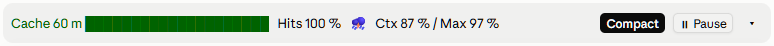

# cache-wetter

[](https://github.com/DarthSonic/cache-wetter/actions/workflows/ci.yml)
[](LICENSE)

*Deutsch: [README.de.md](README.de.md)*

A [Claude Code](https://code.claude.com) mod: one slim band directly above the prompt that tells you how warm the
prompt cache still is and how full the context is, with a **Compact** button and a **Pause / Resume** button that has
Claude finish what is running, save its state and wait.



*Wetter* is German for weather: the band forecasts when your context is about to storm into an auto-compact.

## What the band shows

| Part | What it shows |
| --- | --- |
| **Cache** | Minutes left (`m`) of the prompt cache since the last response, with 20 cells that run empty; green, yellow in the last quarter, red in the last tenth, “expired” at 0. Redrawn every minute. |
| **Hits** | The share of the last response's input tokens that came from the cache. |
| **Weather** | ☀️ up to half the auto-compact threshold, 🌧️ up to 80 % of it, ⛈️ above. |
| **Ctx / Max** | Context fill in percent and the auto-compact threshold (`*`: the fallback of 83 %, when the session reports none). |
| **Compact** | Same as `/compact`; highlighted during ⛈️. In the desktop app, or while Claude is working, `/compact` is queued. |
| **⏸ Pause / ▶ Resume** | Asks Claude to pause the session, and carries on (below). Also shown when the band is folded. |
| **▾ / ▸** | Folds the band to weather, cache time, Ctx and the pause button. Remembered across sessions. |

After `/compact` (or the button) the mod writes the token count before and after and the summary Claude carries on
with as log lines, which the model does not read.

## The pause button

| State | Band | What happens |
| --- | --- | --- |
| working | `⏸ Pause` | A press hands Claude the pause request. |
| pause requested | `⏳ Pause requested · 2 tasks still running` | Claude lets running work finish, asks about long tasks and saves the state. Typing “continue” takes the request back. |
| paused | `▶ Resume` · `paused for 12 m` | Claude waits. A press sends “continue”, exactly as if you had typed it. |

You can also type: a message that is only “pause” (or “pausieren”) pauses; one that starts with “continue” or
“resume” (or “weitermachen”) carries on. Both languages are understood whatever the mod's language is.

The request Claude gets (full text in [`hooks/pause.ts`](hooks/pause.ts)):

1. Start nothing new; whatever is running finishes.
2. Estimate the remaining time of each background task (runs, agents, monitors, workflows). For one that will take
   longer than the threshold (**5 minutes** by default, option `askAboveMinutes`) or has no foreseeable end, ask you —
   as a dialog where available, with each task's remaining time — whether to stop it now and restart it after resuming
   (only if it can be restarted) or to let it finish. Shorter tasks are simply waited for.
3. Save the state following the project's rules (CLAUDE.md, memory): what is done, what ran, what was stopped and how
   to restart it, what comes next. Without a project rule: discard nothing, commit nothing unasked.
4. Report “Paused” briefly and wait. Scheduled wakeups (cron, `/loop`) do not run during the pause.

On “continue” Claude is told to carry on from the saved state and restart what was stopped for the pause. A message
written during the pause is answered without picking the paused work back up.

How the mod tracks the state:

- **Pressed while Claude works:** the request joins the running turn as a row Claude reads at its next request (after
  the tool call in progress). Should the turn end before that, the Stop hook keeps Claude from stopping and hands the
  request on; after an interrupted turn the next message carries it.
- **Pressed while Claude is idle:** the request goes in as a prompt in your words.
- **Paused** is reached once Claude stops and the Stop hook reports no background work in flight. While tasks still
  run the band counts them.
- A pause is kept per session in `~/.claude/cache-wetter/state.json`, so a session reopened while paused (an app
  restart, a resumed session) shows **Resume** again. `/clear` ends the pause.

## Install

At the prompt of a Claude Code session in a terminal:

```
/plugin install cache-wetter --marketplace DarthSonic/cache-wetter
```

Answer `y` to add the marketplace and pick a scope (user: every project). The same from a shell:

```
claude plugin marketplace add DarthSonic/cache-wetter
claude plugin install cache-wetter@cache-wetter --scope user
```

A mod installed at the user scope from a terminal also loads in the Claude desktop app's Code tab.

**After an update, open a new session.** The desktop app hands the mod to a session when the session starts;
`/reload-plugins` does not swap it there. Which version a session runs is written to `codeVersion` in
`~/.claude/cache-wetter/state.json` at every load.

## Settings

| Option | Default | What it does |
| --- | --- | --- |
| `language` | `auto` | `de` or `en` for the band, the toasts and the texts Claude gets. `auto` follows Claude Code's `language` setting, then `LC_ALL` / `LC_MESSAGES` / `LANG`, then the system locale (on Windows, where `LANG` is usually unset). |
| `askAboveMinutes` | `5` | From which remaining time of a running task Claude asks at a pause. |

Set them with `/plugin configure cache-wetter@cache-wetter`, or in `~/.claude/settings.json`:

```json
"pluginConfigs": {
  "cache-wetter@cache-wetter": { "options": { "language": "en", "askAboveMinutes": 10 } }
}
```

## Sharing the band with other mods

The space above the prompt is one site with a chain of mods. A mod that returns only its own band hides every mod
beneath it in the chain, and the load order — not the mod — decides which comes first. cache-wetter calls the rest of
the chain and stacks what comes back below its own row, with a row gap that only appears between the two. Another mod
that does the same (for example [savvy-progress](https://github.com/JohnnyVizz/claude-kit) since 1.2.1) shows
together with it in either order.

## Where the values come from

- **Cache lifetime (5 min / 1 h):** from the session's transcript, which records every cache write split by lifetime
  (`ephemeral_5m_input_tokens`, `ephemeral_1h_input_tokens`); the latest write that wrote anything decides. For a
  transcript over 3.5 MiB only its last 40 lines are read. On a model switch the switch's own report decides; until the
  first reading, the last session's value is shown with `?`.
- **Hit rate and time of the last response:** from every model request of the main conversation.
- **Context and threshold:** `$.session.usage()`; the threshold from the local estimate (no API request).

## State file

`~/.claude/cache-wetter/state.json` holds the paused sessions (by session id), whether the band is folded, the cache
lifetime last seen and the version last loaded. It keeps at most the 20 latest pauses, and ten seconds after a session
starts it drops the pauses of deleted sessions (no transcript left under `~/.claude/projects/`); when in doubt it drops
nothing. Only the mod reads the file — it never reaches the model and costs no tokens.

## Requirements

Claude Code with mods (function-hook plugins), early access, checked with **2.1.295** and **2.1.296**. The mod API
moves between releases; the CI runs validation and the tests against a pinned version.

Where an organization manages Claude Code, the hooks on `classic.SessionStart`, `classic.Stop`,
`classic.PostModelSwitch` and `session.compact` run only for plugins the organization lists in managed settings. A
self-installed copy then never sees Claude stop, so the pause stays at “Pause requested”, the cache lifetime is not
read off the transcript, and no summary is logged after `/compact`.

## Development

```
claude plugin validate .
claude plugin test .
```

The tests (`tests/`) run in Claude Code's own test kit on the terminal and desktop surfaces and pin the language, so
they do not depend on the machine's locale. A change reaches your own sessions after a version bump in
`.claude-plugin/plugin.json`, `claude plugin update cache-wetter@cache-wetter` and a new session.

## License

[MIT](LICENSE) © 2026 Sven Moderow
