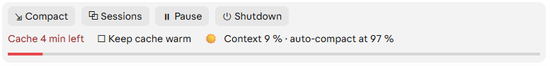

# cache-weather-and-pause-resume

[](https://github.com/DarthSonic/cache-weather-and-pause-resume/releases/latest)
[](https://github.com/DarthSonic/cache-weather-and-pause-resume/actions/workflows/ci.yml)
[](LICENSE)
[](https://www.claudepluginhub.com/plugins/darthsonic-cache-weather-and-pause-resume?ref=badge)

*Deutsch: [README.de.md](README.de.md)*


> [!TIP]
> **Free and open source.** If the band saves you time or cache, you can support its development:
>
> [](https://github.com/sponsors/DarthSonic)

A [Claude Code](https://code.claude.com) mod for stepping away. **Pause** has Claude finish what is running, save its
state and wait, in this session or in all of them, until you press **Resume**. **Shutdown** pauses them the same way
and then shuts the computer down, puts it to sleep or hibernates it. Around that, one slim band directly above the
prompt shows how warm the prompt cache still is, with a **Keep-warm** checkbox that refreshes it shortly before it
runs out, and how full the context is, with a **Compact** button and an overview of all sessions.

## Examples

1. **Step away while a long run is going.** Claude has a test suite running in the background and you need to leave.
   Press **Pause**: Claude starts nothing new, lets the run finish (or asks you first, with its remaining time, when
   it will take longer than 5 minutes), notes where it stands and reports “Paused”. Back at your desk, press
   **Resume** and Claude carries on from there, even after the app was restarted.
2. **Come back before the cache runs out.** The band counts down the prompt cache since the last response, say
   `Cache 12 m`. Send your next message before it reaches “expired”, and the request reads the conversation from the
   cache instead of paying to write all of it again; the share after the slash (`Cache 12 m / 98 %`) shows how much
   came from the cache.
3. **Compact when it suits you.** The weather turns ⛈️ as the context nears the auto-compact threshold (`Ctx 87 % /
   97 %`). Press **Compact** between two tasks instead of letting an auto-compact cut into one; the band then logs
   the summary Claude carries on with.
4. **Keep the cache warm through a long run or a break.** Claude waits for a build that takes 70 minutes, or you are
   in a meeting. **Keep-warm**, on by default, refreshes the cache shortly before it runs out, so the next request
   reads the conversation from the cache instead of writing all of it again.
5. **Leave for the night.** Press **Shutdown**: Claude asks right away about anything long still running, then pauses
   as with **Pause**, the other sessions with it; once all are paused, the band counts down 5 minutes and shuts the
   computer down.

You can also type: “pause” pauses, “continue” resumes (in German “pausieren” and „weitermachen“). Or ask Claude in
any words (“let's stop here for today”): once paused, Claude tells the band, which then shows **Resume**.

## What the band shows


| Part | What it shows |
| --- | --- |
| **Cache** | Minutes left of the prompt cache since the last response or keep-warm refresh; green, yellow from 60 % of the lifetime left, red from 20 %, “expired” at 0. Redrawn every minute. Then the hit rate: the share of the last response's input tokens that came from the cache (`Cache 42 min left · Hits 98 %` in the desktop app, `Cache 42 m / 98 %` in a terminal). |
| **Keep-warm** | A checkbox, “☐ / ☑ Keep cache warm” in the desktop app, `[ ]` / `[✓] Keep-warm` in a terminal, checked by default: refreshes the cache shortly before it runs out (below). “(refreshed 2×)”, `↻2` in a terminal, counts the refreshes since the last request; why keep-warm waits, when it does, stands in the status row. |
| **Weather** | ☀️ up to half the auto-compact threshold, 🌧️ up to 80 % of it, ⛈️ above. In a terminal ☼ (yellow), ≋ (light blue) and ↯ (red). |
| **Context** | Context fill in percent and the auto-compact threshold (`Context 5 % · auto-compact at 97 %` in the desktop app, `Ctx 5 % / 97 %` in a terminal; “about 83 %”, `83 %*` in a terminal: the fallback, when the session reports none). |
| **Compact** | Same as `/compact`; highlighted during ⛈️. In the desktop app, or while Claude is working, `/compact` is queued. |
| **Sessions** | Opens a pane with every session on the computer that runs the mod (below). |
| **Pause / Resume** | Asks Claude to pause the session, and carries on (below). |
| **Shutdown** | Pauses like **Pause**, the other sessions with it, then shuts the computer down after a 5-minute countdown (below). Dimmed where the computer cannot be shut down unattended; a press says what is missing. |
| **Cache bar** | A line of its own below the band, over its width, coloured as the cache time: in a terminal a line in the middle of the row, in the desktop app a bar a few pixels high. |
| **Status row** | Under the bar, one row per message and only while there is one, the most pressing first: the shutdown's countdown, the pause being prepared and the tasks still running, how long the session has been paused (`Paused for 12 min`), a usage window from 80 % on (`5-hour limit 84 % · resets at 15:00`, red from 95 %), about how many turns are left until auto-compact from ten on (`Auto-compact in about 6 turns`, yellow from three; from the median growth of the last five turns, once there are three, and only where the session reports its own threshold), why keep-warm waits, the shutdown check a press waits for. |

In the desktop app each button is a one-colour icon with its word: ⇲ Compact, ⧉ Sessions, ⏸ Pause, ▶ Resume,
⏻ Shutdown (⏾ Standby, ❄ Hibernate), ✕ Cancel, in a row of their own over the readings. A terminal shows the words
alone, in the readings' row.

Shortly before the cache runs out, its time and bar turn red; once it has expired, the hit rate and the context are
hidden until the next response: they describe a request that no longer reads from the cache.




A terminal gets narrow signs instead of emoji: terminals count an emoji's width in their own way (some one column,
Claude Code two), and the band would keep leftovers of an earlier frame. The desktop app draws the emoji.

After `/compact` (or the button) the mod writes the token count before and after and the summary Claude carries on
with as log lines, which the model does not read.

## The pause button

| State | Band | What happens |
| --- | --- | --- |
| working | `Pause` | A press hands Claude the pause request. |
| pause being prepared | `Resume`; status row `⏳ Preparing the pause … · 2 tasks still running` | Claude lets running work finish, asks about long tasks and saves the state. **Resume**, or typing “continue”, calls the request off. |
| paused | `Resume`; status row `Paused for 12 min` | Claude waits. A press sends “continue”, exactly as if you had typed it. |


You can also type: a message that is only “pause” (or “pausieren”) pauses; one that starts with “continue” or
“resume” (or “weitermachen”) carries on. Both languages are understood whatever the mod's language is.

In other words, or in another language, the pause goes through Claude: the mod gives Claude a tool,
`pause_state`, whose description holds the same steps as the request below. Claude calls it with `paused` once it has
finished pausing, and with `running` when you pick the work back up, in whatever words; the band follows and keeps
the pause as the button does. The button and the words above keep working on their own.

The request Claude gets (full text in [`hooks/pause.ts`](hooks/pause.ts)):

1. Start nothing new; whatever is running finishes. Steps that would need your approval wait for “continue”.
2. Estimate the remaining time of each background task (runs, agents, monitors, workflows). For one that will take
   longer than the threshold (**5 minutes** by default, option `askAboveMinutes`) or has no foreseeable end, ask you —
   as a dialog where available, with each task's remaining time — whether to stop it now and restart it after resuming
   (only if it can be restarted) or to let it finish. Shorter tasks are simply waited for.
3. Save the state following the project's rules (CLAUDE.md, memory): what is done, what ran, what was stopped and how
   to restart it, what comes next. Without a project rule: discard nothing, commit nothing unasked.
4. Report “Paused” briefly and wait. Scheduled wakeups (cron, `/loop`) do not run during the pause.

On “continue” Claude is told to carry on from the saved state and restart what was stopped for the pause. A message
written during the pause is answered without picking the paused work back up.

**Approvals.** From the press of **Pause** or **Shutdown** until the pause is over, no new approval comes up: a step
that would ask for your permission waits for “continue”, in every permission mode. In **Auto** Claude Code's own
check settles most steps itself, so fewer of them wait; the mod only takes the mode as a hint, since Auto too may ask
(after a repository's rules or settings hooks), and turns away every prompt that does come up. The request tells Claude so, and a call that asks anyway is
turned away with the same words; Claude notes it in the pause state and repeats it after “continue”, where you are
asked as usual. An approval that is already on screen when you press the button holds the pause up, and a shutdown
with it, until someone answers it: a mod cannot cancel it, so the status row says so and asks you to answer it (“An
approval is open, and the mod cannot cancel it: please answer it so the pause can be set up”). During a shutdown the
other sessions' row names one that waits for an answer or approval the same way. Calls inside a running subagent are
left alone: the run you let finish would fail on them.

How the mod tracks the state:

- **Pressed while Claude works:** the request joins the running turn as a row Claude reads at its next request (after
  the tool call in progress). Should the turn end before that, the Stop hook keeps Claude from stopping and hands the
  request on; after an interrupted turn the next message carries it.
- **Pressed while Claude is idle:** the request goes in as a prompt in your words.
- **Paused** is reached once Claude stops and the Stop hook reports no background work in flight, or when Claude
  reports it through `pause_state`. While tasks still run the band counts them.
- A pause is kept per session in `~/.claude/cache-weather-and-pause-resume/state.json`, so a session reopened while paused (an app
  restart, a resumed session) shows **Resume** again. `/clear` ends the pause.

## The shutdown button

**Shutdown** sits beside **Pause** and ends the day for you:

1. A press first asks when (0.11.0): Claude puts a dialog to you, as soon as possible, or at a time or after a while
   (free text). As soon as possible, Claude gets the pause request (above) with one more note: the computer goes off
   afterwards, so Claude asks about long-running tasks right away, while you are still there, and about the runs of
   the other sessions at work (below), and asks nothing after that.
2. The status row shows “Preparing the shutdown …” and the tasks still running; **Cancel** stands in the button row.
3. Once this session and the others are paused, the status row counts down 5 minutes (“Shutdown in 4:47”, **Cancel** above), then the mod runs the
   system's command and logs a line. Pressed while the session is already paused, it counts down at once. As the
   countdown starts, a notification goes out through your terminal's notification channel (below).

Picking the work back up (**Resume**, “continue”, or Claude through `pause_state`) cancels a shutdown that was asked
for; the pause itself is kept as always.

**At a time (0.11.0).** Answer the question with a time (“02:30”) or a while (“in 2 hours”), or tell Claude in your own
words (“shut the computer down at 02:30, the download needs until then”): Claude passes it to the mod's tool
`schedule_shutdown`, and every band shows “Shutdown planned for 02:30” with **Cancel** in the button's place. Claude
tells you that work still running then can delay it by a few minutes; it never comes earlier. Should the option
`shutdownMode` change before then, the computer does what it says at the time.

- **Until then** every session works on, but starts only steps that surely finish before that time. It asks nothing
  and starts nothing that would need your approval: both wait for after the restart, noted in the saved state. In the
  permission mode **Auto** Claude Code's own check settles most steps itself, so the sessions work on with far fewer
  interruptions; the mod works without it too.
- **Half an hour before,** a session at work is reminded to save its state (a commit, notes), so everything can be
  picked up after the restart.
- **At the time,** every session pauses: running work finishes, the state is saved, nothing is asked. Once all are
  paused, the band counts down one minute (nobody is there to cancel), then runs the command. After the restart each
  session shows **Resume**.
- **The plan is kept in the state file:** it outlives a restart of the app, and should the session that planned it be
  closed, another session with the mod fires it. With none running at the time (the computer was off or asleep), it
  lapses with a line at the next start.
- **Claude's own command to power the computer off is turned away:** a shell command for it (`shutdown /s`,
  `Stop-Computer`, `systemctl poweroff`, `pmset sleepnow` and the like, also inside `powershell -Command` or
  `bash -c`) gets the tool to use instead, so the sessions pause first. The check reads the command as written; a
  shutdown inside a script file it runs is not seen. `shutdown /a` and restarts stay Claude's to run.
- **The computer does what the option `shutdownMode` says;** should you ask for another of shutdown, standby and
  hibernation, Claude tells you to change the option.

**What it needs.** The button is dimmed until the computer can be shut down with nobody at the keyboard; a press then
says what is missing. The mod checks at each session start, and again at a press that finds no answer:

| System | Check | Command | Where it is missing |
| --- | --- | --- | --- |
| Windows | `whoami /priv` lists `SeShutdownPrivilege` (the right “Shut down the system”, which a normal account has) | `shutdown /s /f /t 10` | an administrator grants the right in the local security policy |
| Linux | `loginctl can-power-off` answers `yes` (usually so for a local desktop login), else `sudo -n -l shutdown` succeeds | `systemctl poweroff`, else `sudo -n shutdown -h now` | allow `shutdown` without a password: `sudo visudo -f /etc/sudoers.d/shutdown` with the line `YOUR_NAME ALL=(root) NOPASSWD: PATH` (PATH from `command -v shutdown`) |
| macOS (not yet tested on a Mac) | `sudo -n -l shutdown` succeeds | `sudo -n shutdown -h now` | the same sudoers line, with `/sbin/shutdown` |

**Standby or hibernation instead.** With the option `shutdownMode` the button puts the computer to sleep
(`sleep`) or into hibernation (`hibernate`) instead of shutting it down; the button, the status row and the
notification are named after it (“Standby in 4:47”). Nothing is closed: the other programs and the Claude sessions
are there again when the computer wakes, still paused until you press **Resume**. Each mode is checked at session
start like the shutdown:

| Mode | System | Check | Command |
| --- | --- | --- | --- |
| `sleep` | Windows | `powercfg /a` lists standby (S3 or S0) as available | Windows PowerShell with the system's own `SetSuspendState('Suspend')` |
| `sleep` | Linux | `loginctl can-suspend` answers `yes` | `systemctl suspend` |
| `sleep` | macOS (not yet tested on a Mac) | `pmset` is there | `pmset sleepnow` |
| `hibernate` | Windows | `reg query …\Control\Power /v HibernateEnabled` reads 1 (turn it on as administrator with `powercfg /hibernate on`) | `shutdown /h` |
| `hibernate` | Linux | `loginctl can-hibernate` answers `yes` | `systemctl hibernate` |

On macOS hibernation is a setting of `pmset`, not a command: the button there offers standby or shutdown.

Standby and hibernation are checked and tested, but have not yet run on real hardware (the checks and the dimmed
button have, on Windows). Reports are welcome as an issue.

**Mind:**

- On Windows a shutdown closes the other programs without asking (`/f`; Windows implies it for any delay), so that no “apps
  are preventing shutdown” screen waits for someone who left. Save your work in other programs first.
- Sessions that run the mod pause first ([Other sessions](#other-sessions)); sessions without it end with the computer.
- macOS is not yet tested on a real Mac: the button follows the same path as on Linux (a password-free sudo), and
  where that fails the band says so. If you have a Mac, [issue #1](https://github.com/DarthSonic/cache-weather-and-pause-resume/issues/1) lists what to try.

## Other sessions

The band knows the other Claude Code sessions on the computer that run the mod: each writes a sign of life into the
state file every 15 seconds (its folder, its pause, how long Claude has been working there, its background runs by
description, and for the overview its context against its threshold, when its cache lapses, keep-warm and its model).

**The overview.** The **Sessions** button (⧉ in the desktop app) opens a pane with each of them, this session first:
its state (working for 12 min, paused for 3 min, idle, waiting for an approval), `Ctx 42 % / 97 %`, the cache time
left, keep-warm, the model and the runs in the background; above them the usage windows of a subscription. It only
shows; pausing and shutting down across sessions go through the band, as below.


- **Pause** stays with its own session unless you say otherwise. Where other sessions have work running, the pause
  request lists them, and Claude asks once, in the same question as about its own long tasks: this session only, or
  all of them, and for each session at work whether its runs end now or finish first.
- **Shutdown** always takes them; Claude only asks, for each session at work, whether its runs end now or are waited
  for.
- Claude passes your answer on through a second tool, `pause_sessions`. From then on the band turns question dialogs
  away until the pause is over: what Claude still wants to ask waits for “continue”.
- The other sessions take the request up within 15 seconds. One with no run, no prompt being worked on and no dialog
  open counts as paused at once and shows **Resume**, without a prompt. One at work gets the pause with no question to
  ask (“ask the person nothing now”), its runs ended or let finish as you answered; its status row says where the pause
  came from (`Paused for 3 min · from repo-a`).
- The shutdown waits for the sessions still at work (`Shutdown waits for 1 session: repo-b`): for runs you chose to
  wait for without limit, for a session that never took the request up 15 minutes at most, and not at all for one whose
  sign of life stopped. Then it counts down 5 minutes.
- **Cancel** calls the shutdown off everywhere; the pauses stay. **Resume** where you pressed Pause or Shutdown picks
  the other sessions back up too; **Resume** in one of them picks up that one alone.
- Sessions without the mod, or with a version before 0.9.4, are not paused: the status row counts the ones at work
  (`1 more session is at work without the mod and is not paused`). A session opened after the request was decided is
  no part of it.

## Keep-warm

The prompt cache holds the conversation for 5 minutes or 1 hour after the last request reads it. When it has run out,
the next request writes all of it again: 1.25 times (5 minutes) or 2 times (1 hour) the normal input price, where a
read costs a tenth of it or less. With **Keep-warm** checked the mod refreshes the cache shortly before it runs out:

- **When:** a minute before the end of a 5-minute cache, five minutes before the end of a 1-hour cache.
- **How:** one question over the conversation as its last request sent it (`$.model.fork`, through the session's own
  client and login). The API reads all of it from the cache, which keeps the cache for another full lifetime. The
  question is fixed text (“reply with OK”, in [`hooks/register.tsx`](hooks/register.tsx)); it may call no tool, and
  question and answer stay out of the conversation. Each refresh writes a dim line: the tokens read from the cache, the
  tokens of the reply, and what going on now would save.
- **What it saves:** each refresh's line ends with what going on now would save against building the cache again,
  as a share and in input tokens' worth (“…; continuing now saves ≈ 92 % (≈ 835,500 input tokens' worth)”). When you
  are back, the first request that reads that cache confirms it in a line (“↻ Keep-warm saved ≈ 92 % (≈ 835,500 input
  tokens' worth): 2 refreshes instead of rebuilding the cache.”). Where the cache lapses unused (keep-warm ended or was
  switched off, and nobody went on before its lifetime ran out), or keep-warm finds it already gone, a line says what
  the refreshes cost for nothing.
- **What it would have saved:** with keep-warm off, the request that writes a lapsed cache again says what keep-warm
  would have saved, where it would have bridged the gap within its idle span (“Keep-warm would have saved ≈ 90 % here
  (≈ 269,900 input tokens' worth): the cache had expired and was written again; 3 refreshes would have kept it
  warm.”).
- **The prices:** a cache read is priced at the session model's rate: a tenth of the input price, on
  Claude Opus 5.5 a twentieth, on Claude Fable 5.1 and Mythos 5.1 a fortieth (a model the mod does not know at a
  tenth, which rather understates the saving); a write at 1.25 times (5-minute cache) or twice (1-hour cache); the
  reply at five times.
- **While Claude works** (a long run, a subagent, a pause being requested): for as long as it takes.
- **While the session is idle or paused, or Claude waits for you** (a permission prompt, a question): for 8 hours with the 1-hour cache (option `keepWarmHours`, 1 to 18), for 45 minutes with the 5-minute one,
  counted from the last request or input. Then the status row says “Keep-warm: stopped after 8 h without input”, and a line explains
  why: a forgotten session should not keep spending. Your next message builds the cache again and keep-warm takes
  over again.
- **When a refresh finds the cache already gone** (the machine slept, say), keep-warm waits for the next request
  rather than build it afresh, and says so.
- **After `/compact` or a switch to another model** there is nothing to keep warm: the conversation, or the model, has
  no cache yet, and the next request writes the new one. The band shows the cache expired at once, and keep-warm says
  why it waits (“Keep-warm: waiting for the next request, as there is no cache yet after the compaction”, or “… after
  the model switch”). Where a switch forfeits a cache that
  was still warm, a line says what writing it again costs: the tokens and Claude Code's own estimate (“Model switched
  to claude-sonnet-5-5: … writes 180,000 tokens to the cache again, ≈ $0.72 (list price)”).
- **When the usage runs short:** with a subscription, once the 5-hour or the 7-day window stands at 90 % or more,
  keep-warm refreshes nothing (“Keep-warm: stopped, usage at 92 %”), so it does not spend the last of it, and goes on
  by itself once the window starts over. The status row shows each window from 80 % on, with the time it resets; a
  session on an API key has no windows and shows none.
- **Only answered requests count:** one that failed read nothing from the cache and starts nothing over.
- **On by default, then your switch alone:** a new session starts with keep-warm checked (with the option `keepWarm`
  set to `off`, unchecked). The mod never checks or unchecks it; your choice holds for this session: a restart or a
  resume keeps it, a new session and `/clear` start as the option says.

A refresh is a request of its own and is billed or counted like one: it reads the whole context from the cache, plus
a few tokens of reply. It pays off when the next request comes later than the cache would have lasted.

## Install

The mod is listed in the marketplace `darthsonic`, the catalog
[DarthSonic/claude-plugins](https://github.com/DarthSonic/claude-plugins); each plugin there lives in a repository of
its own. At the prompt of a Claude Code session in a terminal:

```
/plugin marketplace add DarthSonic/claude-plugins
/plugin install cache-weather-and-pause-resume@darthsonic
```

Pick a scope (user: every project). The same from a shell:

```
claude plugin marketplace add DarthSonic/claude-plugins
claude plugin install cache-weather-and-pause-resume@darthsonic --scope user
```

A mod installed at the user scope from a terminal also loads in the Claude desktop app's Code tab.

**Coming from `cache-wetter`** (the name up to 0.5.0): remove it first, with
`claude plugin uninstall cache-wetter@cache-wetter` and `claude plugin marketplace remove cache-wetter`. Its state file
(`~/.claude/cache-wetter/`) is not carried over and can be deleted.

**After an update, open a new session.** The desktop app hands the mod to a session when the session starts;
`/reload-plugins` does not swap it there. Which version a session runs is written to `codeVersion` in
`~/.claude/cache-weather-and-pause-resume/state.json` at every load.

## Settings

| Option | Default | What it does |
| --- | --- | --- |
| `language` | `auto` | `de` or `en` for the band, the toasts and the texts Claude gets. `auto` follows `LC_ALL` / `LC_MESSAGES` / `LANG`, then the system locale (on Windows, where `LANG` is usually unset). |
| `askAboveMinutes` | `5` | From which remaining time of a running task Claude asks at a pause. |
| `keepWarm` | `on` | Whether a new session starts with keep-warm checked; `off` starts it unchecked. |
| `keepWarmHours` | `8` | How long keep-warm goes on with the 1-hour cache in a session nobody works in: 1 to 18 hours. Up to 18 a refresh costs less than building the cache again (a tenth of the input price or less, on Opus 5.5 a twentieth, against twice); about 16 keeps it warm overnight. The 5-minute cache keeps 45 minutes. |
| `notifications` | `on` | A notification as the shutdown countdown starts; `off` sends none. |
| `shutdownMode` | `shutdown` | What the shutdown button does: `shutdown`, `sleep` (standby) or `hibernate`; the button is named after it. |

Set them with `/plugin configure cache-weather-and-pause-resume@darthsonic`, or in `~/.claude/settings.json`:

```json
"pluginConfigs": {
  "cache-weather-and-pause-resume@darthsonic": { "options": { "language": "en", "askAboveMinutes": 10 } }
}
```

## Sharing the band with other mods

The space above the prompt is one site with a chain of mods. A mod that returns only its own band hides every mod
beneath it in the chain, and the load order — not the mod — decides which comes first. cache-weather-and-pause-resume calls the rest of
the chain and stacks what comes back below its own row, with a row gap that only appears between the two. Another mod
that does the same (for example [savvy-progress](https://github.com/JohnnyVizz/claude-kit) since 1.2.1) shows
together with it in either order.

## Where the values come from

- **Cache lifetime (5 min / 1 h):** from the session's transcript, which records every cache write split by lifetime
  (`ephemeral_5m_input_tokens`, `ephemeral_1h_input_tokens`); the latest write that wrote anything decides. A
  transcript over 3.5 MiB is not read (since Claude Code 2.1.300 a transcript also records each request's system prompt
  and tools, so a long session gets there early). On a model switch the switch's own report decides, and a resumed
  session's start tells it when its last response is 5 to 60 minutes old (whether Claude Code calls the cache likely
  expired). Until a reading of its own, a session shows the lifetime last seen: plainly when a session read it within
  the last day (it follows your account's setting, not the session), else with `?`.
- **Hit rate and time of the last response:** from every model request of the main conversation; in a resumed session,
  until its first request, from the session start's report of how long ago the last response was.
- **Context and threshold:** `$.session.usage()`; the threshold from the local estimate (no API request).

## What the mod does on your machine

An independent catalogue, [awesome-claude-code-mods](https://mods.aidojo.si/mods/DarthSonic--cache-weather-and-pause-resume--cache-weather-and-pause-resume/), scans the mod and records what it can reach:
[](https://mods.aidojo.si/mods/DarthSonic--cache-weather-and-pause-resume--cache-weather-and-pause-resume/)
[](https://mods.aidojo.si/mods/DarthSonic--cache-weather-and-pause-resume--cache-weather-and-pause-resume/)

cache-weather-and-pause-resume makes no network requests of its own but for keep-warm's refreshes, and starts programs only for
the shutdown button (below). What it hands Claude enters the conversation like anything else you send:

| What | When | Exactly |
| --- | --- | --- |
| a prompt in your name | you press **Pause** while Claude is idle | the pause request: fixed text from [`hooks/pause.ts`](hooks/pause.ts), with your `askAboveMinutes` |
| the same, with a note | you press **Shutdown** | the pause request and a fixed note that the computer goes off afterwards |
| a prompt in your name | you press **Resume** | “continue” (in German „weitermachen“) |
| a row in the conversation | you press **Pause** while Claude works, or **Resume** | the pause request; a fixed note that the pause is over, with its length in minutes |
| a note added to your prompt | a pause is requested or on, or you type “pause” or “continue” | a fixed note (the request, “the session is paused”, “the pause is over”); the text you typed is never changed, and no prompt is held back |
| the slash command `/compact` | you press **Compact** while Claude works, or in the desktop app | queued like a typed `/compact`; otherwise the button compacts through the session's own compaction call |
| the Stop hook's answer | Claude stops before it read the pause request | Claude goes on once, with the pause request as the reason |
| a list in the pause or shutdown request | you press **Pause** or **Shutdown** while other sessions are at work | each one's short id and folder, how long Claude has been working there and the descriptions of its background runs, from their signs of life; then the question to ask you and the tool to pass the answer on |
| a prompt or a row in your name | another session's pause (where you answered that all pause) or shutdown reaches a session at work | the pause from another session: fixed text from [`hooks/sessions.ts`](hooks/sessions.ts), naming that session's folder and whether the runs end or finish; ask nothing now |
| a tool Claude can call, `pause_sessions` | Claude passes on your answer about the other sessions | listed with a fixed description; a call writes the answer into the request and changes nothing else |
| a dialog turned away | a question dialog once the pause's question is answered, or in a session paused from another | refused with fixed text: keep the question for “continue” |
| an approval turned away | a step of the main conversation that would ask for your approval, from the press of **Pause** or **Shutdown** until the pause is over (or in a session paused from another) | refused with fixed text from [`hooks/sessions.ts`](hooks/sessions.ts): do not run it, note it in the pause state and repeat it after “continue” |
| a tool Claude can call, `pause_state` | Claude has paused the session, or picks the paused work back up | listed for Claude with a fixed description (in [`hooks/pause.ts`](hooks/pause.ts)); a call changes only the band's pause state and the state file, is answered by the mod and runs nothing else |
| a prompt in your name | you press **Shutdown** | the question when: fixed text from [`hooks/sessions.ts`](hooks/sessions.ts) |
| a tool Claude can call, `schedule_shutdown` | you answered when, or asked in words to shut down, sleep or hibernate | listed with a fixed description (in [`hooks/sessions.ts`](hooks/sessions.ts)); now: the pause and shutdown as above; at a time: a plan in the state file, the answer fixed text |
| a note to a session at work, a note added to your prompt | a shutdown is planned | fixed text: the time, start only what finishes before it, ask nothing, save the state; half an hour before, a reminder; at the time, the pause |
| a question or an approval turned away | from the plan until its time, in every session | refused with fixed text: keep it for after the restart and note it |
| a shell command turned away | Claude runs a command that powers the computer off, sends it to sleep or hibernates it | refused with fixed text: use `schedule_shutdown` |
| a question beside the conversation | **Keep-warm** is checked and the cache is about to run out | a model request over the conversation as its last request sent it, through the session's own client: fixed text asking for “OK”, no tools; the answer is discarded and stays out of the conversation |

No file content, transcript text or setting goes into these texts; the list of other sessions names their folders and the descriptions of their background runs. Keep-warm's request carries the conversation the
session sends with every request anyway, to the same API.

**Files.** The mod writes two files, `~/.claude/cache-weather-and-pause-resume/state.json` and, for a pause or
shutdown across sessions, `request.json` beside it (below), and no other: no settings, instructions, hooks or build
files. It reads those, the session's transcript when it is at most 3.5 MiB (for the cache lifetime and the time of the
last response), and the file names and times — not the contents — in `~/.claude/projects/*/`, to drop the pauses of
deleted sessions and, during a shutdown, to count the sessions at work without the mod.

**Programs.** At each session start (and at a press of **Shutdown** that finds no answer) it checks whether the
shutdown button can work: `whoami /priv` on Windows;
elsewhere `uname -s`, then `loginctl can-power-off` (Linux) and `sudo -n -l shutdown`, which asks for no password and
runs nothing; for standby or hibernation `powercfg /a` or `reg query` on Windows, `loginctl can-suspend` or
`can-hibernate` on Linux, all of which only read. Only once you pressed the button, the sessions are paused and the
5-minute countdown has run out does it run the command from the tables above. It starts no other program, and each one by its full path in the
system's own folders (`%SystemRoot%\System32` on Windows, `/usr/bin` or `/bin` elsewhere) with that folder as the
working folder: a program of the same name in the session's folder or on your PATH is never run.

**Notifications.** As the shutdown countdown starts, the mod raises one notification through Claude Code's own
channel, the one your `preferredNotifChannel` setting names: “Shutdown in 5 min” and the session's folder name, fixed
text otherwise. Terminals that show notifications (iTerm2, kitty, Ghostty) show it; elsewhere it is at most the bell.
The desktop app draws no terminal: there nothing comes, and the app reports the pause itself, which is when the
countdown starts. The mod starts no program for it; the option `notifications` turns it off.

**Environment and settings.** It reads `USERPROFILE` / `HOME` (where the home folder is), `LC_ALL` / `LC_MESSAGES` /
`LANG` (the language) and `OS` (whether it runs on Windows). It reads no Claude Code settings and no credentials; the
usage windows come from Claude Code itself, as its status line shows them, and no request of the mod's asks for them.

**Hooks.** The `prompt.submit` and `classic.Stop` hooks act as in the table above, and `tool.call` answers the mod's
own tools, turns a question dialog away during a pause or before a planned shutdown, and turns away a shell command
that powers the computer off; `classic.PermissionRequest` turns away a permission prompt during a pause or before a
planned shutdown, and `tool.check` does so early where the permission mode surely asks (`default`, `plan`,
`acceptEdits`, read from the classic hooks as a hint); neither changes any other verdict, allows anything or touches
a subagent's calls. Every other
hook only reads and passes its event
on unchanged: `classic.UserPromptSubmit` and `classic.PostToolUse` (the permission mode), `classic.SessionStart` (transcript path, session id, time since the last response),
`classic.Stop` (transcript path, running background tasks), `classic.PostModelSwitch` (the cache lifetime, and
whether the model changed), `classic.Notification` (a permission prompt waits for you), `tool.call` otherwise (when a call of the
conversation has run, and when a question to you is answered), `turn.step` (token counts, the model it names, and when a request reads
the cache) and `session.measure` (token counts, and the usage windows of a subscription), `turn.start`, `turn.complete`, `session.end`, and `session.compact`,
after which it logs the summary as lines the model does not read. The `ui.render` hook draws the
band, the sessions overview and stacks the bands of other mods beneath it; `ui.press` opens the overview when you
press **Sessions**.

## State file

`~/.claude/cache-weather-and-pause-resume/state.json` holds the paused sessions and the sessions where you switched keep-warm on or
off (by session id), the cache lifetime last seen and the version last loaded. It keeps at most the 20
latest of each, and ten seconds after a session starts it drops what it holds of deleted sessions (no transcript left
under `~/.claude/projects/`); when in doubt it drops nothing. Only the mod reads the file — it never reaches the model and costs no tokens.

It also holds each session's sign of life (`liveSessions`, see [Other sessions](#other-sessions)): written every 15
seconds, taken out when the session ends, forgotten an hour after its last one. `request.json` beside it holds the
last pause or shutdown across sessions; only the session that made it writes it.

Every session writes the file, each by reading it, changing it and writing it whole. So that two writing at the same
moment lose nothing, a write is looked at again a quarter of a second later and made again where another session's
write took its change back; a file caught half-written is read again, not written over.

## Requirements

The mod works without it, but with far fewer interruptions in the permission mode **Auto**: during a pause and before
a planned shutdown it turns away every permission prompt, and in Auto Claude Code's own check settles most steps
itself, so fewer of them wait.

Claude Code with mods (function-hook plugins), early access, checked with **2.1.317** (desktop app) and **2.1.319** (CLI). The mod API
moves between releases; the CI runs validation and the tests against a pinned version.

Where an organization manages Claude Code, the hooks on `classic.SessionStart`, `classic.Stop`,
`classic.Notification`, `classic.PostModelSwitch`, `classic.UserPromptSubmit`, `classic.PostToolUse`, `classic.PermissionRequest` and `session.compact` run only for plugins the organization lists in
managed settings. A self-installed copy then never sees Claude stop, so the pause stays at “Preparing the pause …”, the cache
lifetime is not read off the transcript, no summary is logged after `/compact`, keep-warm counts an open
permission prompt as work and goes on after a compaction or a switch of model until a refresh finds the cache cold,
and a permission prompt during a pause or before a planned shutdown is not turned away.

## Development

```
claude plugin validate .
claude plugin test .
```

The tests (`tests/`) run in Claude Code's own test kit on the terminal and desktop surfaces and pin the language, so
they do not depend on the machine's locale. A change reaches your own sessions after a version bump in
`.claude-plugin/plugin.json`, `claude plugin update cache-weather-and-pause-resume@darthsonic` and a new session.

How to try a change from a clone and open a pull request: [CONTRIBUTING.md](CONTRIBUTING.md).

## Support

Questions, bugs and ideas: [GitHub issues](https://github.com/DarthSonic/cache-weather-and-pause-resume/issues). The
mod needs no account and no sample data: install it and open a session. Report a security problem privately, as
[SECURITY.md](SECURITY.md) describes, not in an issue. What comes next: [ROADMAP.md](ROADMAP.md).

If the band saves you time or cache, you can support its development through
[GitHub Sponsors](https://github.com/sponsors/DarthSonic).

## Credits

cache-weather-and-pause-resume is based on an idea by Julian Ivanov ([KI-Automatisierungs-Community](https://ki-automatisierungs-community.de/)).
Some of keep-warm's rules follow [cachebeat](https://github.com/ARahim3/cachebeat) by ARahim3, which keeps the cache
warm with a Stop hook that wakes Claude.

Written with Claude Code (Claude Opus 5.5); reviewed, tested and maintained by Sven Moderow.

## License

[MIT](LICENSE) © 2026 Sven Moderow
