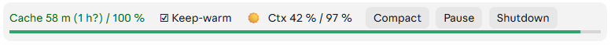
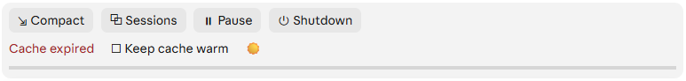
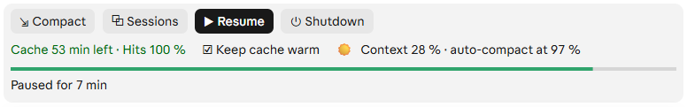

# cache-weather-and-pause-resume

[](https://github.com/DarthSonic/cache-weather-and-pause-resume/actions/workflows/ci.yml)
[](LICENSE)

*Deutsch: [README.de.md](README.de.md)*

A [Claude Code](https://code.claude.com) mod: one slim band directly above the prompt that tells you how warm the
prompt cache still is and how full the context is, with a **Compact** button, a **Pause / Resume** button that has
Claude finish what is running, save its state and wait, a **Keep-warm** checkbox that refreshes the cache shortly
before it runs out, and a **Shutdown** button that pauses the session and then shuts the computer down.




## Examples

1. **Step away while a long run is going.** Claude has a test suite running in the background and you need to leave.
   Press **Pause**: Claude starts nothing new, lets the run finish (or asks you first, with its remaining time, when
   it will take longer than 5 minutes), notes where it stands and reports “Paused”. Back at your desk, press
   **Resume** and Claude carries on from there, even after the app was restarted.
2. **Come back before the cache runs out.** The band counts down the prompt cache since the last response, say
   `Cache 12 m`. Send your next message before it reaches “expired”, and the request reads the conversation from the
   cache instead of paying to write all of it again; the share after the slash (`Cache 12 m / 98 %`) shows how much
   came from the cache.
3. **Compact when it suits you.** The weather turns ⛈️ as the context nears the auto-compact threshold (`Ctx 87 % /
   97 %`). Press **Compact** between two tasks instead of letting an auto-compact cut into one; the band then logs
   the summary Claude carries on with.
4. **Keep the cache warm through a long run or a break.** Claude waits for a build that takes 70 minutes, or you are
   in a meeting. **Keep-warm**, on by default, refreshes the cache shortly before it runs out, so the next request
   reads the conversation from the cache instead of writing all of it again.
5. **Leave for the night.** Press **Shutdown**: Claude asks right away about anything long still running, then pauses
   as with **Pause**; once paused, the band counts down 60 seconds and shuts the computer down.

You can also type: “pause” pauses, “continue” resumes (in German “pausieren” and „weitermachen“). Or ask Claude in
any words (“let's stop here for today”): once paused, Claude tells the band, which then shows **Resume**.

## What the band shows

| Part | What it shows |
| --- | --- |
| **Cache** | Minutes left (`m`) of the prompt cache since the last response or keep-warm refresh; green, yellow from 60 % of the lifetime left, red from 20 %, “expired” at 0. Redrawn every minute. After the slash the hit rate: the share of the last response's input tokens that came from the cache (`Cache 42 m / 98 %`). |
| **Keep-warm** | A checkbox, `[ ]` / `[✓]` in a terminal, ☐ / ☑ in the desktop app, checked by default: refreshes the cache shortly before it runs out (below). `↻2` counts the refreshes since the last request; beside it why keep-warm waits, when it does. |
| **Weather** | ☀️ up to half the auto-compact threshold, 🌧️ up to 80 % of it, ⛈️ above. In a terminal ☼ (yellow), ≋ (light blue) and ↯ (red). |
| **Ctx** | Context fill in percent and, after the slash, the auto-compact threshold (`Ctx 5 % / 97 %`; `*`: the fallback of 83 %, when the session reports none). |
| **Compact** | Same as `/compact`; highlighted during ⛈️. In the desktop app, or while Claude is working, `/compact` is queued. |
| **Pause / Resume** | Asks Claude to pause the session, and carries on (below). |
| **Shutdown** | Pauses like **Pause**, then shuts the computer down after a 60-second countdown (below). Dimmed where the computer cannot be shut down unattended; a press says what is missing. |
| **Cache bar** | A line of its own below the band, over its width, coloured as the cache time: in a terminal a line in the middle of the row, in the desktop app a bar a few pixels high. |

Once the cache has expired, the hit rate and Ctx are hidden until the next response: they describe a request that no
longer reads from the cache.



A terminal gets narrow signs instead of emoji: terminals count an emoji's width in their own way (some one column,
Claude Code two), and the band would keep leftovers of an earlier frame. The desktop app draws the emoji.

After `/compact` (or the button) the mod writes the token count before and after and the summary Claude carries on
with as log lines, which the model does not read.

## The pause button

| State | Band | What happens |
| --- | --- | --- |
| working | `Pause` | A press hands Claude the pause request. |
| pause requested | `⏳ Pause requested · 2 tasks still running` | Claude lets running work finish, asks about long tasks and saves the state. Typing “continue” takes the request back. |
| paused | `Resume` | Claude waits. A press sends “continue”, exactly as if you had typed it. |



You can also type: a message that is only “pause” (or “pausieren”) pauses; one that starts with “continue” or
“resume” (or “weitermachen”) carries on. Both languages are understood whatever the mod's language is.

In other words, or in another language, the pause goes through Claude: the mod gives Claude a tool,
`pause_state`, whose description holds the same steps as the request below. Claude calls it with `paused` once it has
finished pausing, and with `running` when you pick the work back up, in whatever words; the band follows and keeps
the pause as the button does. The button and the words above keep working on their own.

The request Claude gets (full text in [`hooks/pause.ts`](hooks/pause.ts)):

1. Start nothing new; whatever is running finishes.
2. Estimate the remaining time of each background task (runs, agents, monitors, workflows). For one that will take
   longer than the threshold (**5 minutes** by default, option `askAboveMinutes`) or has no foreseeable end, ask you —
   as a dialog where available, with each task's remaining time — whether to stop it now and restart it after resuming
   (only if it can be restarted) or to let it finish. Shorter tasks are simply waited for.
3. Save the state following the project's rules (CLAUDE.md, memory): what is done, what ran, what was stopped and how
   to restart it, what comes next. Without a project rule: discard nothing, commit nothing unasked.
4. Report “Paused” briefly and wait. Scheduled wakeups (cron, `/loop`) do not run during the pause.

On “continue” Claude is told to carry on from the saved state and restart what was stopped for the pause. A message
written during the pause is answered without picking the paused work back up.

How the mod tracks the state:

- **Pressed while Claude works:** the request joins the running turn as a row Claude reads at its next request (after
  the tool call in progress). Should the turn end before that, the Stop hook keeps Claude from stopping and hands the
  request on; after an interrupted turn the next message carries it.
- **Pressed while Claude is idle:** the request goes in as a prompt in your words.
- **Paused** is reached once Claude stops and the Stop hook reports no background work in flight, or when Claude
  reports it through `pause_state`. While tasks still run the band counts them.
- A pause is kept per session in `~/.claude/cache-weather-and-pause-resume/state.json`, so a session reopened while paused (an app
  restart, a resumed session) shows **Resume** again. `/clear` ends the pause.

## The shutdown button

**Shutdown** sits beside **Pause** and ends the day for you:

1. A press hands Claude the pause request (above) with one more note: the computer goes off afterwards, so Claude asks
   about long-running tasks right away, while you are still there, and asks nothing after that.
2. The band shows “Shutdown requested”, the tasks still running and a **Cancel** button.
3. Once the session is paused, the band counts down 60 seconds (“Shutdown in 47 s”, **Cancel**), then the mod runs the
   system's command and logs a line. Pressed while the session is already paused, it counts down at once.

Picking the work back up (**Resume**, “continue”, or Claude through `pause_state`) cancels a shutdown that was asked
for; the pause itself is kept as always.

**What it needs.** The button is dimmed until the computer can be shut down with nobody at the keyboard; a press then
says what is missing. The mod checks once per session start:

| System | Check | Command | Where it is missing |
| --- | --- | --- | --- |
| Windows | `whoami /priv` lists `SeShutdownPrivilege` (the right “Shut down the system”, which a normal account has) | `shutdown /s /f /t 10` | an administrator grants the right in the local security policy |
| Linux | `loginctl can-power-off` answers `yes` (usually so for a local desktop login), else `sudo -n -l shutdown` succeeds | `systemctl poweroff`, else `sudo -n shutdown -h now` | allow `shutdown` without a password: `sudo visudo -f /etc/sudoers.d/shutdown` with the line `YOUR_NAME ALL=(root) NOPASSWD: PATH` (PATH from `command -v shutdown`) |
| macOS (not yet tested on a Mac) | `sudo -n -l shutdown` succeeds | `sudo -n shutdown -h now` | the same sudoers line, with `/sbin/shutdown` |

**Mind:**

- On Windows the other programs are closed without asking (`/f`; Windows implies it for any delay), so that no “apps
  are preventing shutdown” screen waits for someone who left. Save your work in other programs first.
- Other Claude Code sessions on the computer end with it.
- macOS is not yet tested on a real Mac: the button follows the same path as on Linux (a password-free sudo), and
  where that fails the band says so. Reports are welcome as an issue.

## Keep-warm

The prompt cache holds the conversation for 5 minutes or 1 hour after the last request reads it. When it has run out,
the next request writes all of it again: 1.25 times (5 minutes) or 2 times (1 hour) the normal input price, where a
read costs a tenth of it or less. With **Keep-warm** checked the mod refreshes the cache shortly before it runs out:

- **When:** a minute before the end of a 5-minute cache, five minutes before the end of a 1-hour cache.
- **How:** one question over the conversation as its last request sent it (`$.model.fork`, through the session's own
  client and login). The API reads all of it from the cache, which keeps the cache for another full lifetime. The
  question is fixed text (“reply with OK”, in [`hooks/register.tsx`](hooks/register.tsx)); it may call no tool, and
  question and answer stay out of the conversation. Each refresh writes a dim line: the tokens read from the cache and
  the tokens of the reply.
- **While Claude works** (a long run, a subagent, a pause being requested): for as long as it takes.
- **While the session is idle or paused, or Claude waits for you** (a permission prompt, a question): for 8 hours with the 1-hour cache, for 45 minutes with the 5-minute one,
  counted from the last request or input. Then the band says “stopped after 8 h without input”, and a line explains
  why: a forgotten session should not keep spending. Your next message builds the cache again and keep-warm takes
  over again.
- **When a refresh finds the cache already gone** (the machine slept, say), keep-warm waits for the next request
  rather than build it afresh, and says so.
- **After `/compact` or a switch to another model** there is nothing to keep warm: the next request writes the new
  cache, and keep-warm waits for it (“waiting for the next request”).
- **Only answered requests count:** one that failed read nothing from the cache and starts nothing over.
- **On by default, then your switch alone:** a new session starts with keep-warm checked (with the option `keepWarm`
  set to `off`, unchecked). The mod never checks or unchecks it; your choice holds for this session: a restart or a
  resume keeps it, a new session and `/clear` start as the option says.

A refresh is a request of its own and is billed or counted like one: it reads the whole context from the cache, plus
a few tokens of reply. It pays off when the next request comes later than the cache would have lasted.

## Install

The mod is listed in the marketplace `darthsonic`, the catalog
[DarthSonic/claude-plugins](https://github.com/DarthSonic/claude-plugins); each plugin there lives in a repository of
its own. At the prompt of a Claude Code session in a terminal:

```
/plugin marketplace add DarthSonic/claude-plugins
/plugin install cache-weather-and-pause-resume@darthsonic
```

Pick a scope (user: every project). The same from a shell:

```
claude plugin marketplace add DarthSonic/claude-plugins
claude plugin install cache-weather-and-pause-resume@darthsonic --scope user
```

A mod installed at the user scope from a terminal also loads in the Claude desktop app's Code tab.

**Coming from `cache-wetter`** (the name up to 0.5.0): remove it first, with
`claude plugin uninstall cache-wetter@cache-wetter` and `claude plugin marketplace remove cache-wetter`. Its state file
(`~/.claude/cache-wetter/`) is not carried over and can be deleted.

**After an update, open a new session.** The desktop app hands the mod to a session when the session starts;
`/reload-plugins` does not swap it there. Which version a session runs is written to `codeVersion` in
`~/.claude/cache-weather-and-pause-resume/state.json` at every load.

## Settings

| Option | Default | What it does |
| --- | --- | --- |
| `language` | `auto` | `de` or `en` for the band, the toasts and the texts Claude gets. `auto` follows `LC_ALL` / `LC_MESSAGES` / `LANG`, then the system locale (on Windows, where `LANG` is usually unset). |
| `askAboveMinutes` | `5` | From which remaining time of a running task Claude asks at a pause. |
| `keepWarm` | `on` | Whether a new session starts with keep-warm checked; `off` starts it unchecked. |

Set them with `/plugin configure cache-weather-and-pause-resume@darthsonic`, or in `~/.claude/settings.json`:

```json
"pluginConfigs": {
  "cache-weather-and-pause-resume@darthsonic": { "options": { "language": "en", "askAboveMinutes": 10 } }
}
```

## Sharing the band with other mods

The space above the prompt is one site with a chain of mods. A mod that returns only its own band hides every mod
beneath it in the chain, and the load order — not the mod — decides which comes first. cache-weather-and-pause-resume calls the rest of
the chain and stacks what comes back below its own row, with a row gap that only appears between the two. Another mod
that does the same (for example [savvy-progress](https://github.com/JohnnyVizz/claude-kit) since 1.2.1) shows
together with it in either order.

## Where the values come from

- **Cache lifetime (5 min / 1 h):** from the session's transcript, which records every cache write split by lifetime
  (`ephemeral_5m_input_tokens`, `ephemeral_1h_input_tokens`); the latest write that wrote anything decides. A
  transcript over 3.5 MiB is not read (since Claude Code 2.1.300 a transcript also records each request's system prompt
  and tools, so a long session gets there early). On a model switch the switch's own report decides, and a resumed
  session's start tells it when its last response is 5 to 60 minutes old (whether Claude Code calls the cache likely
  expired). Until a reading of its own, a session shows the lifetime last seen: plainly when a session read it within
  the last day (it follows your account's setting, not the session), else with `?`.
- **Hit rate and time of the last response:** from every model request of the main conversation; in a resumed session,
  until its first request, from the session start's report of how long ago the last response was.
- **Context and threshold:** `$.session.usage()`; the threshold from the local estimate (no API request).

## What the mod does on your machine

cache-weather-and-pause-resume makes no network requests of its own but for keep-warm's refreshes, and starts programs only for
the shutdown button (below). What it hands Claude enters the conversation like anything else you send:

| What | When | Exactly |
| --- | --- | --- |
| a prompt in your name | you press **Pause** while Claude is idle | the pause request: fixed text from [`hooks/pause.ts`](hooks/pause.ts), with your `askAboveMinutes` |
| the same, with a note | you press **Shutdown** | the pause request and a fixed note that the computer goes off afterwards |
| a prompt in your name | you press **Resume** | “continue” (in German „weitermachen“) |
| a row in the conversation | you press **Pause** while Claude works, or **Resume** | the pause request; a fixed note that the pause is over, with its length in minutes |
| a note added to your prompt | a pause is requested or on, or you type “pause” or “continue” | a fixed note (the request, “the session is paused”, “the pause is over”); the text you typed is never changed, and no prompt is held back |
| the slash command `/compact` | you press **Compact** while Claude works, or in the desktop app | queued like a typed `/compact`; otherwise the button compacts through the session's own compaction call |
| the Stop hook's answer | Claude stops before it read the pause request | Claude goes on once, with the pause request as the reason |
| a tool Claude can call, `pause_state` | Claude has paused the session, or picks the paused work back up | listed for Claude with a fixed description (in [`hooks/pause.ts`](hooks/pause.ts)); a call changes only the band's pause state and the state file, is answered by the mod and runs nothing else |
| a question beside the conversation | **Keep-warm** is checked and the cache is about to run out | a model request over the conversation as its last request sent it, through the session's own client: fixed text asking for “OK”, no tools; the answer is discarded and stays out of the conversation |

No file content, transcript text or setting goes into these texts. Keep-warm's request carries the conversation the
session sends with every request anyway, to the same API.

**Files.** The mod writes one file, `~/.claude/cache-weather-and-pause-resume/state.json` (below), and no other: no settings,
instructions, hooks or build files. It reads that file, the session's transcript when it is at most 3.5 MiB (for the
cache lifetime and the time of the last response), and the file names — not the contents — in `~/.claude/projects/*/`,
to drop the pauses of deleted sessions.

**Programs.** At each session start it checks whether the shutdown button can work: `whoami /priv` on Windows;
elsewhere `uname -s`, then `loginctl can-power-off` (Linux) and `sudo -n -l shutdown`, which asks for no password and
runs nothing. Only once you pressed **Shutdown**, the session is paused and the 60-second countdown has run out does it
run the shutdown command from the table above. It starts no other program, and each one by its full path in the
system's own folders (`%SystemRoot%\System32` on Windows, `/usr/bin` or `/bin` elsewhere) with that folder as the
working folder: a program of the same name in the session's folder or on your PATH is never run.

**Environment and settings.** It reads `USERPROFILE` / `HOME` (where the home folder is), `LC_ALL` / `LC_MESSAGES` /
`LANG` (the language) and `OS` (whether it runs on Windows). It reads no Claude Code settings and no credentials.

**Hooks.** The `prompt.submit` and `classic.Stop` hooks act as in the table above. Every other hook only reads and
passes its event on unchanged: `classic.SessionStart` (transcript path, session id, time since the last response),
`classic.Stop` (transcript path, running background tasks), `classic.PostModelSwitch` (the cache lifetime, and
whether the model changed), `classic.Notification` (a permission prompt waits for you), `tool.call` (when a call of the
conversation has run, and when a question to you is answered; it also answers the mod's own `pause_state`), `turn.step` (token counts, and when a request reads
the cache) and `session.measure` (token counts), `turn.start`, `turn.complete`, `session.end`, and `session.compact`,
after which it logs the summary as lines the model does not read. The `ui.render` hook draws the
band and stacks the bands of other mods beneath it.

## State file

`~/.claude/cache-weather-and-pause-resume/state.json` holds the paused sessions and the sessions where you switched keep-warm on or
off (by session id), the cache lifetime last seen and the version last loaded. It keeps at most the 20
latest of each, and ten seconds after a session starts it drops what it holds of deleted sessions (no transcript left
under `~/.claude/projects/`); when in doubt it drops nothing. Only the mod reads the file — it never reaches the model and costs no tokens.

## Requirements

Claude Code with mods (function-hook plugins), early access, checked with **2.1.317** (desktop app) and **2.1.319** (CLI). The mod API
moves between releases; the CI runs validation and the tests against a pinned version.

Where an organization manages Claude Code, the hooks on `classic.SessionStart`, `classic.Stop`,
`classic.Notification`, `classic.PostModelSwitch` and `session.compact` run only for plugins the organization lists in
managed settings. A self-installed copy then never sees Claude stop, so the pause stays at “Pause requested”, the cache
lifetime is not read off the transcript, no summary is logged after `/compact`, and keep-warm counts an open
permission prompt as work and goes on after a compaction or a switch of model until a refresh finds the cache cold.

## Development

```
claude plugin validate .
claude plugin test .
```

The tests (`tests/`) run in Claude Code's own test kit on the terminal and desktop surfaces and pin the language, so
they do not depend on the machine's locale. A change reaches your own sessions after a version bump in
`.claude-plugin/plugin.json`, `claude plugin update cache-weather-and-pause-resume@darthsonic` and a new session.

## Support

Questions, bugs and ideas: [GitHub issues](https://github.com/DarthSonic/cache-weather-and-pause-resume/issues). The
mod needs no account and no sample data: install it and open a session.

## Credits

cache-weather-and-pause-resume is based on an idea by Julian Ivanov ([KI-Automatisierungs-Community](https://ki-automatisierungs-community.de/)).
Some of keep-warm's rules follow [cachebeat](https://github.com/ARahim3/cachebeat) by ARahim3, which keeps the cache
warm with a Stop hook that wakes Claude.

Written with Claude Code (Claude Opus 5.5); reviewed, tested and maintained by Sven Moderow.

## License

[MIT](LICENSE) © 2026 Sven Moderow
